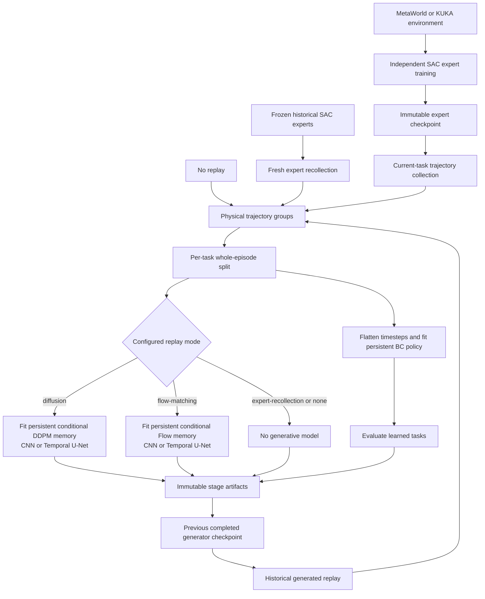

# Project Architecture

This document describes the architecture implemented in this repository. It is
not a proposal for a future framework. The main research pipeline is DiffCRL: a
persistent behavior-cloning (BC) policy learns an ordered task sequence from
current-task trajectories produced by frozen SAC experts and, depending on the
experiment, fresh historical expert recollection or generated replay.

DiffCRL is inspired by DISTR, but the training architecture is materially
different. The original DISTR method continually trains an Immediate Policy
and uses generated trajectories to stabilize that online continual-RL process.
This repository instead trains SAC experts independently, freezes them, and
uses their rollouts as supervision for a persistent `GeneralPolicy`. Its DDPM
trajectory replay is therefore an adaptation of the generative-replay idea,
not an exact reproduction of the DISTR algorithm or protocol.

## 1. Repository overview

```text
continual-learning/
├── train_sac.py                 # independent single-task SAC experts
├── train_diffcrl.py             # expert-driven continual BC/replay pipeline
├── run_replay_comparison.py     # comparison-run orchestration
├── configs/
│   ├── sac/                     # single-task expert presets
│   │   └── cw10/                # stable-tanh CW10 task 2 and tasks 6--10
│   ├── diffcrl/                 # DiffCRL and replay variants
│   ├── local/                   # machine/local experiment presets
│   └── archive/                 # historical reproducibility presets
├── src/
│   ├── config/                  # experiment schemas, strict YAML I/O, validation
│   ├── continual/               # data, replay, BC, generators, evaluation, artifacts
│   └── support/                 # persistence, manifests, hashes, stage sync
├── scripts/
│   ├── collection/              # standalone expert trajectory collection
│   ├── evaluation/              # SAC and continual-policy evaluation
│   └── experiments/             # controlled experiment launch helpers
├── tests/                       # unit, regression, smoke, and integration tests
├── docs/                        # architecture, audits, inventories, experiment notes
└── runs/                        # configured outputs when runtime.output selects it
```

Important modules under `src/continual/` are:

| Module | Responsibility |
|---|---|
| `diffcrl.py` | Explicit seven-step stage orchestration and persistent learning state |
| `diffcrl_artifacts.py` | Checkpoint serialization, stage reports and completion-boundary persistence |
| `collector.py` | Repeated algorithm-side collection over the benchmark rollout contract |
| `diffusion_data.py`, `stage_dataset.py` | Physical trajectory preparation, diagnostics, episode splits and BC flattening |
| `bc_policy.py` | Persistent `GeneralPolicy` with controlled Squashed-Gaussian NLL or deterministic physical-action MSE training |
| `trajectory_diffusion.py` | Conditional DDPM network, objective, sampler and checkpoint loader |
| `trajectory_flow_matching.py` | Conditional Flow Matching network, objective, ODE sampler and checkpoint loader |
| `temporal_unet.py` | Shared three-scale Temporal U-Net body used independently by DDPM and Flow Matching |
| `generator_training.py`, `generator_normalization.py` | Shared fitting lifecycle, device boundary, checkpoint payload and feature normalization |
| `expert_recollection.py`, `diffcrl_replay.py`, `flow_matching_replay.py` | Historical trajectory providers |
| `replay_common.py`, `replay_allocation.py` | Shared replay action handling/provenance and deterministic budget allocation |
| `reporting.py` | DiffCRL report construction and console output using benchmark formatting |

## 2. Implemented system workflow

SAC expert training is a separate prerequisite, not part of a DiffCRL stage.



For stage `k`, `DiffCRLTrainer.train_task()` performs the following order:

1. Generate or load replay for tasks `0..k-1`; stage zero has none.
2. Load the frozen SAC expert for task `k` and, by default, collect all requested
   episodes using deterministic actions.
3. Validate and combine one physical trajectory group per represented task,
   then split whole episodes into training and validation subsets. With the
   optional `historical_replay_training_only` protocol, historical groups are
   excluded from validation.
4. If configured, normalize and fit the persistent DDPM or Flow Matching memory
   directly on the 43D stage dataset. Generator weights persist; its Adam
   optimizer is new for each fit.
5. Fit the persistent `GeneralPolicy` by BC. Policy weights persist, while a new
   Adam optimizer is created for the stage and restored together with the best
   validation epoch.
6. Evaluate the policy on all learned tasks.
7. Commit the completed stage by saving checkpoints and reports and writing the
   completion marker last.

The implemented DiffCRL replay modes are `none`, `expert-recollection`,
`diffusion`, and `flow-matching`. Expert Recollection performs fresh,
deterministic rollouts with frozen historical SAC experts and therefore has
privileged access to old task environments and policies. It is not conventional
stored-data replay. The retired `real` mode remains visible in archival YAML but
is rejected by active validation.

## 3. Environment integration

The standalone `continual_manipulation.environments` API exposes
`make_env(backend, task, seed, ...)` and immutable `EnvironmentSettings`.
Supported backends are `metaworld-v3` and `kuka-v3`; their horizons are obtained through
`horizon_for_backend()` rather than assumed by callers.

The shared policy-facing contract is defined by that standalone package:

- observation shape `(39,)`;
- current state `observation[0:18]`;
- previous state `observation[18:36]`;
- 3D goal `observation[36:39]`;
- continuous action shape `(4,)`.

MetaWorld-v3 environments are created through Gymnasium registration
`Meta-World/MT1`, with `use_one_hot=False`, a 200-step limit,
`terminate_on_success=False`, and a 39D observation wrapper. KUKA-v3 uses the
registered `Meta-World-KUKA/MT1` interface and validates the shared
`reward_function_version`. Hammer and Peg Unplug keep their fixed reward
definitions inside their KUKA-v3 task implementations; task-specific reward
variants and progress coefficients are not public environment or experiment
configuration. `EpisodeSuccessWrapper` accumulates success across the episode
and exposes it as terminal `info["is_success"]`.

The workspace-local KUKA fork is expected beside this repository:

```text
Thesis/
├── continual-learning/
└── metaworld-kuka-v3/
```

Its package metadata names the distribution `metaworld==3.1.1` and includes
both the `metaworld` and `metaworld_kuka` import packages. Install it into the
intended `metaworld` Conda environment so both registrations and local source
changes are visible:

```bash
conda run -n metaworld python -m pip install \
  -e ../metaworld-kuka-v3 \
  --no-deps \
  --no-build-isolation
```

This replaces the public wheel with an editable installation of the same
distribution version. Merely having the sibling directory in the workspace is
not enough: it is not on the Conda interpreter's package path automatically.

## 4. Experts and trajectory collection

`train_sac.py` trains one Stable-Baselines3 SAC expert for the single task in a
SAC configuration. DiffCRL resolves every configured expert path at startup,
validates its manifest/environment contract, records its SHA-256 hash, and
checks that the expert does not change during the run.

New experts use `LegacySACPolicy` from `src/sac_policy.py`. Its actor maps the
39D observation through `Linear(39,256) -> LayerNorm -> Tanh`, followed by three
`Linear(256,256) -> LeakyReLU(0.01)` blocks and separate SB3 Gaussian mean and
log-standard-deviation heads. Each twin critic and target critic applies the
same core to the concatenated 39D observation and 4D action, followed by a
scalar linear head. This reproduces the Legacy neural-network layout, not its
SAC implementation: a localized schedule gate reproduces its separate 10,000-
step random-action period and 50-updates-per-50-steps cadence, while SB3
continues to own Gaussian sampling, losses, entropy tuning, replay, optimizers,
and target updates. The actor's tanh log-Jacobian uses the Legacy algebraically
stable pre-tanh expression instead of SB3's action-space epsilon expression;
this changes neither the actor parameters nor deterministic inference and
prevents saturated float32 actions from losing the correction gradient. New
manifests record this distribution and network combination as
`legacy-continual-diff-pytorch-4x256-stable-tanh-v2`. Historical
`LegacySACPolicy` state dictionaries remain loadable because the distribution
adds no parameters. The original Legacy single-task wrapper's 12D observation
truncation and multi-head selection are intentionally absent.

The formal stable-tanh expert batch under `configs/sac/cw10/` contains six
independent single-task experiments in this order:

```text
push-wall-v3 -> handle-press-side-v3 -> push-v3 -> shelf-place-v3
             -> window-close-v3 -> peg-unplug-side-v3
```

This is Legacy CW10 task 2 followed by tasks 6--10, with environment names
updated from v2 to v3. The ordering belongs only to launch orchestration: every
configuration creates a new SAC model, optimizer, and replay buffer with seed
0. There is no policy, optimizer, replay-buffer, or entropy-state transfer
between tasks. Each run uses one million environment steps, reward v2, fixed
validation banks, and evaluation every 40,000 steps. Outputs are isolated under
`runs/cw10_experts/stable_tanh_v2/reward_v2/<task>/seed_0/`.

`scripts/experiments/train_cw10_six_sequential.sh` is a thin sequential
launcher over those six YAML files. It validates every configuration and target
path before starting, saves one console log per task, and stops on the first
nonzero Python exit status. Because piping through `tee` removes the TTY needed
for SB3's Rich progress rendering, `train_sac.py` disables that interactive bar
and emits an unbuffered progress record from the existing evaluation callback:
step, validation success rate, and mean return. This changes display behavior
only; evaluation cadence and training mathematics are unchanged.

Standalone SAC retains only the atomically replaced `best_model.zip`, selected
lexicographically by validation success rate and then mean episode return.
Exact ties retain the earlier checkpoint. Periodic/final checkpoints, replay
buffer persistence, and resume state are intentionally absent.

`SB3SACPolicy` adapts an already loaded SAC model to the common
`Policy.act(observation, deterministic=True) -> action` boundary. The collector
records each observation immediately before its corresponding action and each
reward after that action. It stops only when Gymnasium reports `terminated` or
`truncated`; reaching the declared horizon without either signal is rejected.

The unpadded `Trajectory` schema is:

| Field | Contract |
|---|---|
| `observations` | finite `(T,39)` array |
| `actions` | finite `(T,4)` array |
| `rewards` | finite `(T,)` array |
| `task_id` | task-name string |
| `episode_return` | sum of valid rewards |
| `success` | success at any step |
| `final_success` | success on the final step |
| `length` | common `T`, `1 <= T <= horizon` |

### Optional task-conditioned behavioral cloning

`bc.task_conditioning` defaults to `none`, preserving the 39D observation
contract. Setting it
to `one_hot` appends a one-hot vector whose ordering is exactly
`continual.tasks`; its width is fixed from the full sequence at stage zero. The
result remains one persistent shared network with the same hidden
layers, LayerNorm, activations, and bounded action output—there are no per-task
heads.

Whole-episode stage labels already used by the conditional generators are
repeated across timesteps when constructing the BC dataset. Consequently,
current expert data and historical diffusion, Flow Matching, or expert recollection
retain their known group identity without changing the physical `(39 + 4)`
trajectory representation or inferring identity from observations. During
evaluation, the known evaluation-task index is passed explicitly to the policy.

Task-conditioned checkpoints record the conditioning mode, full ordered task
list, task count, and resulting input dimension. Loading validates mode and
ordering. Historical deterministic `general_policy_v2` checkpoints are
explicitly rejected by the stochastic loader rather than reinterpreted. This
option is a Task-Incremental Learning protocol: it
provides true task identity at inference and therefore uses a different
information setting from task-agnostic evaluation; it does not expose old
environments or expert policies.

DiffCRL formal packing accepts only full-horizon trajectories. It packs
observation and action into `(N,T,43)` float32 tensors. The standalone
collection entry point is
`scripts/collection/collect_expert_trajectories.py --config ...`; it stores
arrays and a provenance report through `expert_collection.py`.

## 5. Generative replay

### 5.1 Shared infrastructure

There is no formal generator protocol. Both models implement the common core
used by shared code:

```python
model.loss(clean, *, generator, task_ids=None, goals=None)
model.sample(count, *, seed=0, task_ids=None, goals=None, ...)
```

DDPM sampling accepts `execution_mode`. Flow sampling instead accepts
`integration_steps`, `solver`, `rtol`, and `atol`.

`generator_training.py` owns deterministic loss assessment, shuffled minibatch
training, gradient clipping at 1.0, Adam construction, lowest-validation-loss
selection, and the shared checkpoint envelope. `generator_normalization.py`
implements per-feature z-scores fitted over batch and time using population
standard deviation, a `1e-3` scale floor, and no clipping. Generator and goal
normalizers are fitted only from the current stage training split.

Physical `(N,T,43)` data is passed directly to both generators:

```text
(N,T,43) [current 18 + previous 18 + goal 3 + action 4]
        ↓ per-feature normalization
(N,T,43) normalized generator input + (N,3) normalized goal condition
```

Task-ID and normalized 3D reference-goal conditioning remain external inputs,
while the goal is also one of the generated features. There is no trajectory
decoder: generated previous states and goals pass through unchanged. Actions
may be modeled raw or in pre-`tanh` coordinates; optional replay projection
clips only the four generated action coordinates. For historical configuration
and artifact compatibility, these shared generator action settings remain in
the `diffusion` section even when Flow Matching is selected.

Real collected trajectories and generated replay share the stage acceptance
contract: physical `(N,T,43)` shape and finite values. Neither source is
rejected for previous-state misalignment or within-episode goal variation.

Generated replay provenance stores read-only goal deviation/variation,
previous-state alignment and reset error, action-bound violations, and NaN/Inf
counts. These diagnostics never clip or repair data. New checkpoints use
`trajectory_diffusion_43_v3` and `trajectory_flow_matching_43_v3`. Known v2
direct-43D checkpoints remain loadable only as their original Temporal CNN
architectures. Older reduced-representation checkpoints are rejected and are
not converted automatically.

Direct generation does not guarantee previous-state alignment, an episode-
constant goal, or environment-dynamics consistency. This is an intentional
learned relationship rather than a decoder-enforced equality.

### 5.2 DDPM

`trajectory_diffusion.py` contains `TemporalDenoiser`,
`TemporalUNetDenoiser`, and `TrajectoryDiffusion`. The strictly validated
`diffusion.backbone` field selects `temporal_cnn` by default or
`temporal_unet1d`; `diffusion.width` is the CNN width or the U-Net base width.
Only the selected network is instantiated.

```yaml
diffusion:
  backbone: temporal_cnn       # default; use temporal_unet1d for U-Net
  width: 64                    # CNN width or U-Net base width
```

The original `TemporalDenoiser` uses a position channel, discrete sinusoidal
timestep embedding, learned task embedding, projected normalized 3D goal, and
six residual Conv1d blocks with dilations `1,2,4,8,16,32`.
`TemporalUNetDenoiser` retains DDPM's discrete timestep semantics but applies
them to the shared three-scale U-Net body. For base width `w`, its channels are
`[w,2w,4w]`: two encoder scales each have one residual block and stride-2
downsampling, the bottleneck has two residual blocks, and two decoder scales
each resize with nearest interpolation to the exact skip length, convolve, fuse
the skip, and apply one residual block. It uses GroupNorm, SiLU,
ordinary-dilation `k=5`/`k=1` residual blocks and a linear `1x1` output. Even
and odd horizons are supported; the minimum U-Net horizon is four. Neither
backbone clamps or activates its output. Both predict normalized clean data
`x_0`, never noise or velocity.

The U-Net encoder-decoder layers and forward path live in `temporal_unet.py`
and are also used by Flow Matching. This is code reuse, not parameter sharing:
DDPM and Flow Matching instantiate and train separate networks and checkpoints.

The schedule is the squared-cosine schedule with offset `0.008` and beta cap
`0.999`. Training samples a uniform discrete timestep and Gaussian noise:

```math
x_t = \sqrt{\bar\alpha_t}x_0 + \sqrt{1-\bar\alpha_t}\,\epsilon,
\qquad
L = \|f_\theta(x_t,t,c)-x_0\|_2^2.
```

Sampling starts from standard normal noise and applies every ancestral DDPM
posterior step in reverse order. Task index and normalized goal form condition
`c`.

New DDPM checkpoints use kind `trajectory_diffusion_43_v3` and explicitly
serialize backbone identity, U-Net specification version, width, schedule and
the existing action/task configuration. Loading validates the full expected
model configuration supplied by the replay provider, action and task-order
contracts, normalizer shapes/finiteness/positive scales, exact agreement
between stored schedule buffers and the serialized configuration, and strict
model-state compatibility. Known `trajectory_diffusion_43_v2` checkpoints are
interpreted as the original CNN only. Unknown backbones, missing v3 identity,
cross-backbone state and reduced-22D formats are rejected; weights are never
converted between backbones.

### 5.3 Flow Matching

`trajectory_flow_matching.py` contains `TemporalVelocityModel`,
`TemporalUNetVelocityModel`, and `TrajectoryFlowMatching`. The strictly
validated `flow_matching.backbone` field selects `temporal_cnn` by default or
`temporal_unet1d`; `flow_matching.width` is the CNN width or U-Net base width.

```yaml
flow_matching:
  backbone: temporal_unet1d
  width: 32
  integration_steps: 10
  ode_solver: euler
```

`TemporalVelocityModel` is the original six-block dilated temporal ConvNet. It
uses an explicit position channel, learned task embedding, normalized-goal
projection and a continuous sinusoidal time embedding whose scale is set by
`flow_matching.time_embedding_scale`. `TemporalUNetVelocityModel` combines
those Flow-specific conditioning adapters with the shared `[w,2w,4w]` U-Net
body described above. Its linear `1x1` output has no `tanh` or clamp. Both
networks predict velocity; sharing the structural body does not replace Flow
time with DDPM timesteps or change the Flow objective.

With independent standard-normal source `x_0`, data `x_1`, and
`t ~ Uniform[0,1)`, the implemented linear path and target are:

```math
x_t=(1-t)x_0+tx_1,
\qquad
u_t=x_1-x_0,
\qquad
L=\|v_\theta(x_t,t,c)-u_t\|_2^2.
```

Sampling integrates from `t=0` to `t=1` through `torchdiffeq.odeint`. Supported
methods are fixed-step `euler`, `midpoint`, `heun2`, and `rk4`, plus adaptive
`dopri5`. `integration_steps` supplies the fixed step size for fixed-step
methods; neural-function evaluations are measured rather than inferred because
higher-order and adaptive solvers evaluate the velocity field multiple times.
New Flow checkpoints use kind `trajectory_flow_matching_43_v3` and explicitly
record backbone, width and U-Net specification version alongside model state,
both normalizers and replay provenance. Known
`trajectory_flow_matching_43_v2` checkpoints remain supported as the original
CNN only. Loading reconstructs exactly one selected backbone, validates the
complete expected persistent-generator configuration and metadata, and loads
the state dict strictly. Unknown or missing v3 architecture identity and
cross-backbone weights are rejected; no automatic conversion is performed.

### 5.4 DDPM execution modes

The DDPM sampler supports:

- `execution_mode="legacy"` (default): sampling state and CPU generator remain
  on CPU; each neural evaluation moves inputs to the network device and returns
  its output to CPU. This preserves historical random streams.
- `execution_mode="device-native"`: conditions move once, noise is created by an
  explicit generator on the network device, all sampling steps remain there,
  and the final result returns to CPU. Diffusion replay requests can forward
  this mode programmatically; current experiment configurations do not add a
  YAML field for it.

CPU tests establish exact equality between both modes. CUDA uses a CUDA RNG and
is not promised bitwise-equivalent to CPU. CUDA execution has not yet been
validated in the available test environment, and no speedup has been measured.

## 6. Continual learning and replay

`TaskSequence` stores an ordered tuple of unique task names; its integer index
is also the generator task condition. `TaskSwitcher` owns at most one active
environment and closes it before switching.

The algorithm-independent benchmark is the local installable distribution under
`packages/continual-manipulation/`, imported as `continual_manipulation`. It owns task sequences and switching,
the MetaWorld-v3 and KUKA-v3 adapters, deterministic task-bank identities,
evaluation rollout and matrices, and continual-learning metrics. SAC, BC,
DiffCRL, trajectory generators, and replay generation/allocation depend on
that package; the benchmark does not import them or their framework
dependencies. Parent-project consumers import the canonical package directly;
obsolete benchmark shims have been removed.

Replay-specific task-bank state, goal reconstruction, and configuration
sampling remain in `src/continual/task_bank.py`; they consume the benchmark's
canonical bank construction and hashing operations.

### 6.1 Named task sequences

New configurations may replace an explicit `continual.tasks` list with one of
four immutable aliases: `cm1`, `cm3`, `cm5`, or `cm10`. They are prefixes of
this project-defined continual manipulation sequence, which is inspired by
Continual World but is not presented as an official Continual World benchmark:

```text
reach-v3, push-v3, hammer-v3, handle-press-side-v3,
button-press-topdown-v3, faucet-open-v3, drawer-close-v3,
window-close-v3, door-open-v3, peg-unplug-side-v3
```

The loader resolves the alias before trainer construction and persists only the
explicit task list. Thus an alias and its equivalent list have identical
scientific configuration and stage semantics. The sequence is independent of
the environment backend: validation rejects unsupported tasks as a group and
never renames, substitutes, or skips them. In particular, the current KUKA-v3
task identifiers use a `kuka-` prefix, so the MetaWorld CM aliases are rejected
for KUKA configurations; existing explicit KUKA lists remain supported.

`cm20` is intentionally not exposed. A longer benchmark would require an
explicit scientific definition and review of the current unique-task
assumption before implementation. Named curricula do not infer expert paths;
DiffCRL still requires one explicit expert checkpoint for every resolved task.

At stage `k`, generative replay providers reproduce historical task labels and goals from
the saved training task banks. Generated normalized trajectories are
denormalized with the previous checkpoint's statistics into physical
`(N,T,43)` groups, optionally action-projected, and validated before BC. Expert
Recollection instead uses the same training task bank with a dedicated reset-seed
namespace to collect fresh complete rollouts. It never reads archived trajectory
arrays, but deterministic policies and finite task banks do not guarantee unique
trajectories; configuration identities, goals, and exact trajectory hashes are
reported.

Replay allocation supports:

- `generator-default`: legacy DDPM assigns `trajectories_per_task` to every old
  task; Flow uses one fixed total budget.
- `fixed-total`: either generator divides `replay_budget` uniformly across old
  tasks, assigning any remainder in curriculum order.
- `fixed-weighted`: either generator applies the configured nonnegative
  historical-task weights and deterministic largest-remainder rounding while
  preserving the exact total budget.

The `none` mode trains BC only from the current expert group. The recommended
pipeline uses deterministic expert collection (`collection_mode: all`),
physical-action MSE BC, and deterministic fixed-task evaluation. All replay
methods use the same persistent `GeneralPolicy`: an MLP over a raw 39D observation and,
optionally, the fixed-width task one-hot vector. It has exactly four 256-unit
hidden layers and LayerNorm after the first Linear layer. `bc.activation`
supports `relu` (the historical default) and `leaky_relu`. ReLU is applied
after every hidden layer. The Legacy-inspired choice follows the verified
Legacy placement: Tanh after the first Linear+LayerNorm, then LeakyReLU with
negative slope 0.01 after each of the remaining three Linear layers.
This reproduces only the activation placement: the current policy still differs
from Legacy in observation dimension, hidden width, initialization, and training
implementation.
The controlled `bc.loss` objective is either `squashed_gaussian_nll` or
`deterministic_mse`; the historical `squashed-gaussian-nll` spelling remains
accepted so existing configurations are unchanged. Both variants share the
same input, four-layer trunk, first-layer LayerNorm, activation selection,
mean head, tanh action bound, physical action scaling, stage datasets, and
optimizer lifecycle. The NLL variant additionally owns a state-dependent
log-standard-deviation head and minimizes the tanh-corrected likelihood. The
deterministic variant has no log-standard-deviation head and minimizes physical
action MSE. Both select their lowest held-out objective value and are evaluated
through deterministic actions.

The GeneralPolicy width is independently selected by `bc.hidden_dim`: 256 is
the backward-compatible default and 512 is the supported Legacy-capacity
variant; both retain exactly four hidden layers. The prepared 4×512 experiment
also uses experiment-specific BC settings of Adam at `1e-4` for 300 epochs.
Those settings do not change defaults and make the experiment a combined
capacity/training-budget comparison, not a width-only ablation. It preserves
the current 39D observations and Squashed-Gaussian NLL and is not a bit-for-bit
reproduction of Legacy.
Separate linear heads produce the Gaussian mean and state-dependent log
standard deviation, clamped to SB3's `[-20, 2]` bounds. Deterministic inference
uses the squashed mean; stochastic inference reparameterizes a Gaussian sample.
The log-standard-deviation head starts with zero weights and the configured
`bc.initial_log_std` bias; configurations that omit the field retain the
historical `-3` default. Validated experiments may explicitly select another
bias without changing the shared trunk, mean head, or log-standard-deviation
weights. Neither Gaussian output head has an activation. Checkpoints record
the initialization value and activation identity when available, while
older stochastic checkpoints remain loadable and are interpreted as `-3` for
initialization provenance and ReLU when activation metadata is absent. NLL
training then makes the standard deviation state-dependent. Both objective
variants apply the existing affine mapping to environment action bounds. The
Squashed-Gaussian policy and the matched deterministic-MSE variant are the supported active
GeneralPolicy architectures; incompatible objectives and checkpoints are
rejected. Historical deterministic checkpoints remain
unchanged and are specified in
`docs/architecture/DETERMINISTIC_GENERAL_POLICY.md`.

The Legacy-inspired SB3 SAC actor used for independent expert training is
separate from GeneralPolicy. New expert manifests record architecture identity
`legacy-continual-diff-pytorch-4x256-v1`. Existing SB3 archives remain loadable
through their serialized original policy class, but their weights are not
reinterpreted as the new architecture. The removed experimental actor-transfer implementation is
recorded in `docs/archive/SAC_POLICY_TRANSFER_IMPLEMENTATION.md`. In the active
Squashed-Gaussian objective, physical-action MSE remains diagnostic only; in
the deterministic objective, it is the optimized and checkpoint-selection
metric.

## 7. Data contracts

| Data | Shape/type | Producer | Consumer and validation |
|---|---|---|---|
| Environment observation | `(39,)` float | environment adapter | policies and collector; adapter/collector validate shape and finiteness |
| Environment action | `(4,)` continuous | SAC or `GeneralPolicy` | environment and collector; action bounds checked at relevant boundaries |
| Collected episode | `Trajectory`, variable `T` | `collector.py` | `schema.validate_trajectory` |
| Physical stage group | `(N,T,43)` float32 | `pack_trajectories` or replay provider | stage-data and replay validators |
| Generator trajectory input | `(N,T,43)` | packed physical stage data | DDPM/Flow `_validate` |
| Generator goal condition | `(N,3)` float32 | episode goal or task-bank reconstruction | generator condition validation |
| Generator task condition | `(N,)` `torch.long` | stage labels/replay provider | embedding range validation |
| BC dataset | observations `(N*T,39)`, actions `(N*T,4)`, plus optional task IDs `(N*T,)` | `bc_dataset` | `fit_bc` |
| Evaluation cell | returns, success rate, lengths, seeds and provenance | `evaluate_task` | `EvaluationMatrix.record` |

Real and generated physical episodes require the expected shape and finite
values. Previous-state alignment and within-episode goal consistency are
diagnostics rather than acceptance rules for both sources.

## 8. Configuration and reproducibility

`src/config/` defines separate frozen top-level schemas for standalone SAC and
DiffCRL. Small environment, runtime, evaluation, and
algorithm sections are reused only where their fields have the same meaning.
YAML is loaded strictly for the selected entry point; unknown and irrelevant
fields are rejected. CLI overrides include `--seed`, `--device`, and run naming,
plus narrowly scoped entry-point-specific options. Defaults in code are fallback defaults; formal,
smoke, local, and archived YAML files intentionally override them.

Scientifically fixed choices are intentionally absent from active YAML: SAC
uses automatic entropy tuning with the fixed Legacy-inspired four-layer
architecture described above. Its exploration threshold and target output
standard deviation remain explicit because they define the reproduced Legacy
schedule and entropy target. GeneralPolicy
uses the LayerNorm placement described above, and the NLL variant uses fixed
inverse-tanh epsilon `1e-4`; generator
training clips gradients at norm 1 and averages four validation draws; Flow
Matching uses a linear path, standard-normal source noise, and validation-loss
checkpoint selection; replay allocation priority is uniform. DDPM and Flow
Matching expose only `backbone` and `width` for network-structure selection:
the CNN block layout and shared U-Net `[w,2w,4w]` topology remain fixed.
Obsolete keys from historical resolved configs are rejected; archived YAML
remains provenance rather than current input.

Reproducibility mechanisms include:

- explicit Python/NumPy/PyTorch seeds and deterministic local generators;
- whole-episode splits from `numpy.random.default_rng(seed)` with rounded 20%
  validation;
- disjoint configured collection and evaluation seed ranges;
- fixed task banks identified by `task_set_seed` and serialized task hashes;
- seeded model initialization before generator and BC construction;
- lowest-validation-loss selection for generators and Squashed-Gaussian BC;
- SHA-256 hashes for experts and completed-stage artifacts;
- completion markers written after all stage artifacts;
- collision-protected run and stage paths that prevent artifact overwrites.

New output directories and stage directories are collision-protected. Completion
markers are written last and retain SHA-256 identities for synchronization and
offline integrity checks; interrupted runs must be restarted as new runs.

## 9. Evaluation and metrics

`evaluate_task()` runs deterministic actions and consecutive reset seeds. In
`sampled` mode the environment samples tasks on reset. In `fixed-tasks` mode an
ordered backend task bank is generated from `task_set_seed`, task resampling is
disabled, and the selected task identity is verified after every reset.
The canonical implementation is
`continual_manipulation.evaluation`; its policy boundary is the
single `act(observation, deterministic=True)` operation. Algorithm-specific
policy adapters and checkpoint loading remain outside the benchmark.

The matrix entry `R[k,j]` is success rate on task `j` after stage `k`. By
default, stage `k` evaluates tasks `0..k`; future tasks are measured only when
explicitly requested. Each cell also stores mean/std return, success count,
mean episode length, episode-level values, seeds, and task-bank provenance.

Implemented continual metrics are:

```math
AP_k = \frac{1}{k+1}\sum_{j=0}^{k}R[k,j]
```

```math
F_k = \frac{1}{k+1}\sum_{j=0}^{k}\left(R[j,j]-R[k,j]\right).
```

This forgetting definition uses each task's end-of-task diagonal value, not its
maximum historical score; negative values indicate improvement. Missing cells
produce `None`, not zero.

Normalized forward transfer is implemented only for explicitly supplied,
aligned learning and reference curves:

```math
FWT_i = \frac{\operatorname{mean}(A_i)-\operatorname{mean}(B_i)}
              {1-\operatorname{mean}(B_i)}.
```

The regular endpoint evaluation matrix does not supply those curves, so its
serialized `forward_transfer` is currently `null`. Matrices are written as
stage snapshots and as the final `evaluation_matrix.json`.

## 10. Checkpoints and experiment artifacts

| Artifact | Important content | Loader/validation |
|---|---|---|
| SAC expert `.zip` | Success-selected SB3 SAC policy from a fresh standalone run | `SAC.load`; expert manifest and space validation in DiffCRL |
| BC policy `.pt` | objective-specific kind, explicit objective, shared/mean state, optional NLL log-std state, action bounds, optional Adam state/parameter names, stage metadata | `GeneralPolicy.load` / `load_training`, strict objective/architecture/optimizer ownership; historical deterministic v2 rejected |
| DDPM `.pt` | v3 backbone-aware model config/state, schedule, dynamic/goal statistics and replay metadata; known v2 is CNN-only | `TrajectoryDiffusion.load`, expected-config/schedule/normalizer/state validation |
| Flow `.pt` | v3 backbone-aware model config/state, dynamic/goal statistics and stage/replay metadata; known v2 is CNN-only | `TrajectoryFlowMatching.load` with expected-config and metadata checks |
| Stage marker | policy/generator/report/matrix paths and SHA-256 hashes | `diffcrl_artifacts.py` completion-marker validation |

DiffCRL writes root-level policy and generator checkpoints named by stage/task,
a `stage_<index>_<task>/` directory containing physical data and reports, a
stage evaluation matrix snapshot, resolved configuration/manifests, and a
`stage_<index>_COMPLETE.json` marker. The marker is written last. `RUN_COMPLETE`
marks a finished run.

## 11. Testing architecture

Use the intended Conda interpreter from the repository root:

```bash
PYTEST_DISABLE_PLUGIN_AUTOLOAD=1 \
  conda run -n metaworld python -m pytest -q tests/
```

Plugin autoload is disabled because unrelated system or ROS plugins can affect
collection. Lightweight tests cover configuration, data transformations,
normalization, strict generator-backbone selection, CNN regression, U-Net
even/odd/minimum horizons, conditioning and backward passes, deterministic
generator training/sampling, v2/v3 checkpoints, replay providers, BC, metrics,
reporting, and artifact behavior. Environment integration
and KUKA factory/evaluation tests instantiate MuJoCo environments and are slower:

```bash
PYTEST_DISABLE_PLUGIN_AUTOLOAD=1 \
  conda run -n metaworld python -m pytest -q \
  tests/test_kuka_diffcrl_phase1.py tests/test_kuka_v3_sac.py
```

CUDA integration tests exist for DDPM and Flow U-Nets, but the current
CPU-only validation host skips them. Successful CUDA execution and performance
therefore remain unverified. The larger KUKA evaluation group can be
resource-intensive. Tests do not replace full thesis experiment runs.

## 12. Developer guide

| Goal | Primary locations |
|---|---|
| Add or expose an environment task | `packages/continual-manipulation/src/continual_manipulation/environments/`, task/config validation in `src/config/validation.py` |
| Change single-task SAC training | `train_sac.py`, `configs/sac/` |
| Change trajectory collection/schema | `continual_manipulation.evaluation.rollout`, `collector.py`, `diffusion_data.py` |
| Change BC architecture/objective | `bc_policy.py`, `BCConfig` |
| Modify DDPM | `trajectory_diffusion.py`, shared `temporal_unet.py` when applicable, and focused tests |
| Modify Flow Matching | `trajectory_flow_matching.py`, shared `temporal_unet.py` when applicable, and focused tests |
| Change shared generator fitting/normalization | `generator_training.py`, `generator_normalization.py` |
| Change generated replay preparation/allocation | replay provider, `replay_common.py`, `replay_allocation.py` |
| Change stage orchestration | `diffcrl.py`, `stage_dataset.py` |
| Change continual metrics/evaluation | `continual_manipulation.evaluation`, `continual_manipulation.metrics`; `reporting.py` for DiffCRL presentation |
| Change checkpoint/artifact validation | model loader, `diffcrl_artifacts.py`, `src/support/` |

To add another generative replay method without duplicating infrastructure:

1. Implement a model with compatible `loss` and `sample` behavior over normalized
   `(N,T,43)` physical trajectory data.
2. Reuse `FeatureNormalizer`, `fit_generator`, direct trajectory preparation,
   and replay allocation.
3. Add a method-specific checkpoint loader and replay request/provider that
   returns validated physical `(N,T,43)` groups plus provenance.
4. Add the mode to strict configuration validation and the explicit branches in
   `DiffCRLTrainer`; do not hide method-specific contracts in a generic framework.
5. Add deterministic unit, checkpoint, replay, artifact, and stage-integration tests.

## 13. Known limitations

- Device-native sampling is implemented and CPU-tested, but CUDA execution and
  performance have not been validated.
- Legacy sampling intentionally retains CPU state transfers for historical
  reproducibility.
- KUKA-v3 depends on the separately maintained editable sibling checkout; a
  public `metaworld` wheel alone does not provide `metaworld_kuka`.
- Fixed-task evaluation is implemented for MetaWorld-v3 and KUKA-v3.
- Forward transfer requires aligned external learning/reference curves and is
  not derivable from the endpoint matrix alone.
- The repository implements simulated MetaWorld/KUKA environments; no real-robot
  execution path is present in the documented training pipeline.
