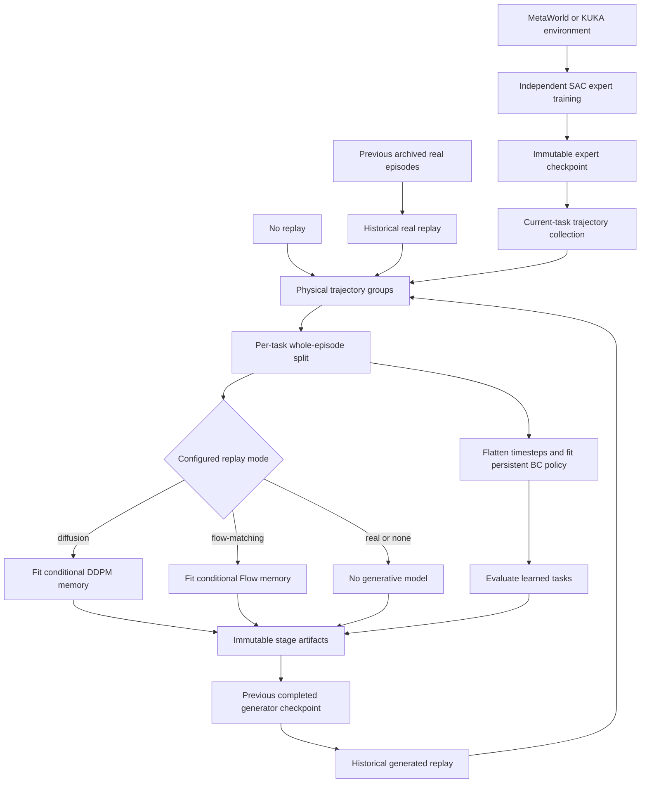

# Project Architecture

This document describes the architecture implemented in this repository. It is
not a proposal for a future framework. The main research pipeline is DiffCRL: a
persistent behavior-cloning (BC) policy learns an ordered task sequence from
current-task trajectories produced by frozen SAC experts and, depending on the
experiment, historical real or generated replay.

## 1. Repository overview

```text
continual-learning/
├── train_sac.py                 # independent single-task SAC experts
├── train_diffcrl.py             # expert-driven continual BC/replay pipeline
├── train_continual_sac.py       # one sequential SAC baseline, no replay
├── run_replay_comparison.py     # comparison-run orchestration
├── configs/
│   ├── sac/                     # single-task expert presets
│   ├── diffcrl/                 # DiffCRL and replay variants
│   ├── continual_sac/           # sequential SAC baseline
│   ├── local/                   # machine/local experiment presets
│   └── archive/                 # historical reproducibility presets
├── src/
│   ├── config.py                # typed configuration, validation, CLI overrides
│   ├── envs.py                  # public environment factory and shared settings
│   ├── env_adapters/            # MetaWorld, KUKA-v2, and KUKA-v3 adapters
│   ├── continual/               # data, replay, BC, generators, evaluation, resume
│   ├── sac/                     # SAC checkpoint ranking and KUKA diagnostics
│   └── support/                 # persistence, manifests, hashes, stage sync
├── scripts/
│   ├── collection/              # standalone expert trajectory collection
│   ├── evaluation/              # SAC and continual-policy evaluation
│   ├── diagnostics/             # task- and trajectory-specific diagnostics
│   ├── flow_matching/           # Flow experiment analysis/validation utilities
│   └── visualization/           # policy rendering
├── tests/                       # unit, regression, smoke, and integration tests
├── docs/                        # architecture, audits, inventories, experiment notes
└── runs/                        # configured outputs when runtime.output selects it
```

Important modules under `src/continual/` are:

| Module | Responsibility |
|---|---|
| `diffcrl.py` | Stage orchestration, expert collection, generator/BC fitting, checkpointing and evaluation |
| `schema.py`, `collector.py` | Validated unpadded episode representation and policy rollout |
| `diffusion_data.py`, `stage_dataset.py` | Physical trajectory packing, generative encoding, episode splits and BC flattening |
| `bc_policy.py` | Persistent deterministic `GeneralPolicy` and BC training |
| `trajectory_diffusion.py` | Conditional DDPM network, objective, sampler and checkpoint loader |
| `trajectory_flow_matching.py` | Conditional Flow Matching network, objective, Euler sampler and checkpoint loader |
| `generator_training.py`, `generator_normalization.py` | Shared fitting lifecycle, device boundary, checkpoint payload and feature normalization |
| `diffcrl_replay.py`, `flow_matching_replay.py`, `real_replay.py` | Historical replay providers |
| `replay_common.py`, `replay_allocation.py` | Shared replay decoding/provenance and deterministic budget allocation |
| `evaluation.py`, `metrics.py`, `reporting.py` | Fixed/sampled evaluation, continual metrics and reports |
| `resume.py` | Completed-stage boundary validation and RNG restoration |

## 2. Implemented system workflow

SAC expert training is a separate prerequisite, not part of a DiffCRL stage.



For stage `k`, `DiffCRLTrainer.train_task()` performs the following order:

1. Generate or load replay for tasks `0..k-1`; stage zero has none.
2. Load the frozen SAC expert for task `k` and collect deterministic episodes.
3. Validate and combine one physical trajectory group per represented task.
4. Split whole episodes into training and validation subsets per task. With the
   optional `historical_replay_training_only` protocol, historical groups are
   excluded from validation.
5. If configured, encode and fit the persistent DDPM or Flow Matching memory on
   the stage dataset. The generator weights persist across stages; its Adam
   optimizer is new for each fit.
6. Fit the persistent `GeneralPolicy` by BC. Policy weights persist, while a new
   Adam optimizer is created for the stage and restored together with the best
   validation epoch.
7. Save stage checkpoints, evaluate the policy on learned tasks, write reports,
   and finally write the completion marker.

The implemented DiffCRL replay modes are `none`, `diffusion`, `flow-matching`,
and `real`. `train_continual_sac.py` is a different baseline: one SAC learner is
carried across tasks, its replay buffer is reset at boundaries, and it does not
use experts, BC, or generative replay.

## 3. Environment integration

`src/envs.py` exposes `make_env(backend, task, seed, ...)` and immutable
`EnvironmentSettings`. Supported backends are `metaworld-v3`, `kuka-v2`, and
`kuka-v3`; their current horizons are all obtained through
`horizon_for_backend()` rather than assumed by callers.

The shared policy-facing contract is defined in `src/env_adapters/__init__.py`:

- observation shape `(39,)`;
- current state `observation[0:18]`;
- previous state `observation[18:36]`;
- 3D goal `observation[36:39]`;
- continuous action shape `(4,)`.

MetaWorld-v3 environments are created through Gymnasium registration
`Meta-World/MT1`, with `use_one_hot=False`, a 200-step limit,
`terminate_on_success=False`, and a 39D observation wrapper. KUKA-v3 uses the
registered `Meta-World-KUKA/MT1` interface and validates task-specific reward and
initialization options. `EpisodeSuccessWrapper` accumulates success across the
episode and exposes it as terminal `info["is_success"]`.

The workspace-local KUKA fork is expected beside this repository:

```text
Thesis/
├── continual-learning/
└── metaworld-kuka-v3/
```

Its package metadata names the distribution `metaworld==3.1.1` and includes
both the `metaworld` and `metaworld_kuka` import packages. Install it into the
intended `metaworld` Conda environment so both registrations and local source
changes are visible:

```bash
conda run -n metaworld python -m pip install \
  -e ../metaworld-kuka-v3 \
  --no-deps \
  --no-build-isolation
```

This replaces the public wheel with an editable installation of the same
distribution version. Merely having the sibling directory in the workspace is
not enough: it is not on the Conda interpreter's package path automatically.

## 4. Experts and trajectory collection

`train_sac.py` trains one Stable-Baselines3 SAC expert for the single task in a
SAC configuration. DiffCRL resolves every configured expert path at startup,
validates its manifest/environment contract, records its SHA-256 hash, and
checks that the expert does not change during the run.

`SB3SACPolicy` adapts an already loaded SAC model to the common
`Policy.act(observation, deterministic=True) -> action` boundary. The collector
records each observation immediately before its corresponding action and each
reward after that action. It stops only when Gymnasium reports `terminated` or
`truncated`; reaching the declared horizon without either signal is rejected.

The unpadded `Trajectory` schema is:

| Field | Contract |
|---|---|
| `observations` | finite `(T,39)` array |
| `actions` | finite `(T,4)` array |
| `rewards` | finite `(T,)` array |
| `task_id` | task-name string |
| `episode_return` | sum of valid rewards |
| `success` | success at any step |
| `final_success` | success on the final step |
| `length` | common `T`, `1 <= T <= horizon` |

DiffCRL formal packing accepts only full-horizon trajectories. It packs
observation and action into `(N,T,43)` float32 tensors. The standalone
collection entry point is
`scripts/collection/collect_expert_trajectories.py --config ...`; it stores
arrays and a provenance report through `expert_collection.py`.

## 5. Generative replay

### 5.1 Shared infrastructure

There is no formal generator protocol. Both models implement the effective
interface used by shared code:

```python
model.loss(clean, *, generator, task_ids=None, goals=None)
model.sample(count, *, seed=0, task_ids=None, goals=None, execution_mode="legacy")
```

Flow sampling additionally accepts `integration_steps` and `progress`.

`generator_training.py` owns deterministic loss assessment, shuffled minibatch
training, gradient clipping at 1.0, Adam construction, lowest-validation-loss
selection, and the shared checkpoint envelope. `generator_normalization.py`
implements per-feature z-scores fitted over batch and time using population
standard deviation, a `1e-3` scale floor, and no clipping. Generator and goal
normalizers are fitted only from the current stage training split.

Physical `(N,T,43)` data is encoded by `diffusion_data.py` as:

```text
(N,T,39) observation + (N,T,4) action
        ↓ remove redundant previous state and separate constant goal
(N,T,22) [current state 18 + action 4] + (N,3) goal
```

Decoding reconstructs previous state exactly by shifting current state and
repeats the supplied goal at every timestep. Actions may be modeled raw or in
pre-`tanh` coordinates; optional replay projection clips only generated actions.

### 5.2 DDPM

`trajectory_diffusion.py` contains `TemporalDenoiser` and
`TrajectoryDiffusion`. The network uses a position channel, discrete sinusoidal
time embedding, learned task embedding, projected normalized 3D goal, and six
dilated residual Conv1d blocks. Its output is normalized clean data `x_0`.

The schedule is the squared-cosine schedule with offset `0.008` and beta cap
`0.999`. Training samples a uniform discrete timestep and Gaussian noise:

```math
x_t = \sqrt{\bar\alpha_t}x_0 + \sqrt{1-\bar\alpha_t}\,\epsilon,
\qquad
L = \|f_\theta(x_t,t,c)-x_0\|_2^2.
```

Sampling starts from standard normal noise and applies every ancestral DDPM
posterior step in reverse order. Task index and normalized goal form condition
`c`.

DDPM checkpoints use kind `trajectory_diffusion_22_v1`. Loading validates the
stored model configuration when an expected configuration is supplied, action
and task-order contracts, normalizer shapes/finiteness/positive scales, exact
agreement between all stored schedule buffers and the serialized configuration,
and strict model-state compatibility. The format and state-dictionary keys are
unchanged from legacy checkpoints.

### 5.3 Flow Matching

`trajectory_flow_matching.py` contains `TemporalVelocityModel` and
`TrajectoryFlowMatching`. Its temporal ConvNet mirrors the DDPM capacity but
uses a continuous sinusoidal time embedding and predicts velocity.

With independent standard-normal source `x_0`, data `x_1`, and
`t ~ Uniform[0,1)`, the implemented linear path and target are:

```math
x_t=(1-t)x_0+tx_1,
\qquad
u_t=x_1-x_0,
\qquad
L=\|v_\theta(x_t,t,c)-u_t\|_2^2.
```

Sampling integrates from `t=0` to `t=1` with fixed-step explicit Euler. The
configured integration step count is also the neural-function-evaluation count.
Flow checkpoints use kind `trajectory_flow_matching_22_v1` and include model
configuration, state, both normalizers, and replay provenance.

### 5.4 Execution modes

Both samplers support:

- `execution_mode="legacy"` (default): sampling state and CPU generator remain
  on CPU; each neural evaluation moves inputs to the network device and returns
  its output to CPU. This preserves historical random streams.
- `execution_mode="device-native"`: conditions move once, noise is created by an
  explicit generator on the network device, all sampling steps remain there,
  and the final result returns to CPU. Replay request objects can forward this
  mode programmatically; current experiment configurations do not add a YAML
  field for it.

CPU tests establish exact equality between both modes. CUDA uses a CUDA RNG and
is not promised bitwise-equivalent to CPU. CUDA execution has not yet been
validated in the available test environment, and no speedup has been measured.

## 6. Continual learning and replay

`TaskSequence` stores an ordered tuple of unique task names; its integer index
is also the generator task condition. `TaskSwitcher` owns at most one active
environment and closes it before switching.

At stage `k`, replay providers reproduce historical task labels and goals from
the saved training task banks. Generated normalized trajectories are
denormalized with the previous checkpoint's statistics, decoded to physical
`(N,T,43)` groups, optionally action-projected, and validated before BC. Real
replay samples with replacement only from archived original training IDs, never
the validation split.

Replay allocation supports:

- `generator-default`: legacy DDPM assigns `trajectories_per_task` to every old
  task; Flow uses one fixed total budget.
- `fixed-total`: either generator divides `replay_budget` uniformly across old
  tasks, assigning any remainder in curriculum order.

The `none` mode trains BC only from the current expert group. All methods use
the same persistent `GeneralPolicy`: an MLP over raw 39D observations with
LayerNorm in the first hidden layer and a final `tanh` mapped to environment
action bounds. BC supports physical post-`tanh` MSE and pre-`tanh` latent MSE;
checkpoint selection always uses held-out physical action MSE.

## 7. Data contracts

| Data | Shape/type | Producer | Consumer and validation |
|---|---|---|---|
| Environment observation | `(39,)` float | environment adapter | policies and collector; adapter/collector validate shape and finiteness |
| Environment action | `(4,)` continuous | SAC or `GeneralPolicy` | environment and collector; action bounds checked at relevant boundaries |
| Collected episode | `Trajectory`, variable `T` | `collector.py` | `schema.validate_trajectory` |
| Physical stage group | `(N,T,43)` float32 | `pack_trajectories` or replay provider | stage-data and replay validators |
| Generator dynamic input | `(N,T,22)` | `encode_trajectory` | DDPM/Flow `_validate` |
| Generator goal condition | `(N,3)` float32 | `encode_trajectory` or task-bank reconstruction | generator condition validation |
| Generator task condition | `(N,)` `torch.long` | stage labels/replay provider | embedding range validation |
| BC dataset | observations `(N*T,39)`, actions `(N*T,4)` | `bc_dataset` | `fit_bc` |
| Evaluation cell | returns, success rate, lengths, seeds and provenance | `evaluate_task` | `EvaluationMatrix.record` |

Within every physical episode, previous state at reset equals current state;
subsequent previous states equal the preceding current states; and the goal is
exactly constant. These invariants are checked when encoding and after replay
decoding.

## 8. Configuration and reproducibility

`src/config.py` defines frozen dataclasses for environment, SAC, BC, diffusion,
Flow Matching, continual, evaluation, and runtime sections. YAML is loaded
strictly for the selected entry point. CLI overrides include `--seed`,
`--device`, output/run naming, plus entry-point-specific options such as
`--resume-from` for DiffCRL. Defaults in code are fallback defaults; formal,
smoke, local, and archived YAML files intentionally override them.

Reproducibility mechanisms include:

- explicit Python/NumPy/PyTorch seeds and deterministic local generators;
- whole-episode splits from `numpy.random.default_rng(seed)` with rounded 20%
  validation;
- disjoint configured collection and evaluation seed ranges;
- fixed task banks identified by `task_set_seed` and serialized task hashes;
- seeded model initialization before generator and BC construction;
- lowest-validation-loss generator selection and lowest physical-action-MSE BC
  selection;
- SHA-256 hashes for experts and completed-stage artifacts;
- completion markers written after all stage artifacts;
- saved/restored Python, NumPy, and PyTorch RNG states at stage boundaries.

New output directories are collision-protected. A resumed interrupted stage
uses `.resume_N` paths rather than overwriting partial artifacts. Resume requires
the same scientific configuration and a contiguous set of hash-valid completion
markers; execution paths and device may differ where explicitly allowed.

## 9. Evaluation and metrics

`evaluate_task()` runs deterministic actions and consecutive reset seeds. In
`sampled` mode the environment samples tasks on reset. In `fixed-tasks` mode an
ordered backend task bank is generated from `task_set_seed`, task resampling is
disabled, and the selected task identity is verified after every reset.

The matrix entry `R[k,j]` is success rate on task `j` after stage `k`. By
default, stage `k` evaluates tasks `0..k`; future tasks are measured only when
explicitly requested. Each cell also stores mean/std return, success count,
mean episode length, episode-level values, seeds, and task-bank provenance.

Implemented continual metrics are:

```math
AP_k = \frac{1}{k+1}\sum_{j=0}^{k}R[k,j]
```

```math
F_k = \frac{1}{k+1}\sum_{j=0}^{k}\left(R[j,j]-R[k,j]\right).
```

This forgetting definition uses each task's end-of-task diagonal value, not its
maximum historical score; negative values indicate improvement. Missing cells
produce `None`, not zero.

Normalized forward transfer is implemented only for explicitly supplied,
aligned learning and reference curves:

```math
FWT_i = \frac{\operatorname{mean}(A_i)-\operatorname{mean}(B_i)}
              {1-\operatorname{mean}(B_i)}.
```

The regular endpoint evaluation matrix does not supply those curves, so its
serialized `forward_transfer` is currently `null`. Matrices are written as
stage snapshots and as the final `evaluation_matrix.json`.

## 10. Checkpoints and experiment artifacts

| Artifact | Important content | Loader/validation |
|---|---|---|
| SAC expert `.zip` | SB3 SAC policy; periodic resume also requires replay-buffer sidecar | `SAC.load`; expert manifest and space validation in DiffCRL |
| BC policy `.pt` | kind, hidden sizes, state, optional Adam state/parameter names, stage metadata | `GeneralPolicy.load` / `load_training`, strict architecture and optimizer ownership |
| DDPM `.pt` | kind, model config/state, dynamic/goal statistics, replay metadata | `TrajectoryDiffusion.load`, schedule/config/normalizer/state validation |
| Flow `.pt` | kind, model config/state, dynamic/goal statistics, stage and replay metadata | `TrajectoryFlowMatching.load` with expected-contract checks |
| Stage boundary | policy/generator/report/matrix paths and hashes, training banks/configurations, RNG state | `resume.py` and completion-marker validation |

DiffCRL writes root-level policy and generator checkpoints named by stage/task,
a `stage_<index>_<task>/` directory containing physical data and reports, a
stage evaluation matrix snapshot, resolved configuration/manifests, and a
`stage_<index>_COMPLETE.json` marker. The marker is written last. `RUN_COMPLETE`
marks a finished run.

## 11. Testing architecture

Use the intended Conda interpreter from the repository root:

```bash
PYTEST_DISABLE_PLUGIN_AUTOLOAD=1 \
  conda run -n metaworld python -m pytest -q tests/
```

Plugin autoload is disabled because unrelated system or ROS plugins can affect
collection. Lightweight tests cover configuration, data transformations,
normalization, deterministic generator training/sampling, checkpoints, replay
providers, BC, metrics, reporting, and resume behavior. Environment integration
and KUKA factory/evaluation tests instantiate MuJoCo environments and are slower:

```bash
PYTEST_DISABLE_PLUGIN_AUTOLOAD=1 \
  conda run -n metaworld python -m pytest -q \
  tests/test_kuka_diffcrl_phase1.py tests/test_kuka_v3_sac.py
```

Current confirmed limitations are that CUDA device-native sampling has not been
tested on a CUDA-capable host, and the larger KUKA evaluation group can be
resource-intensive. Tests do not replace full thesis experiment runs.

## 12. Developer guide

| Goal | Primary locations |
|---|---|
| Add or expose an environment task | `src/env_adapters/`, `src/envs.py`, task/config validation in `src/config.py` |
| Change single-task SAC training | `train_sac.py`, `configs/sac/`, `src/sac/` |
| Change trajectory collection/schema | `collector.py`, `schema.py`, `diffusion_data.py` |
| Change BC architecture/objective | `bc_policy.py`, `BCConfig` |
| Modify DDPM | `trajectory_diffusion.py` and its focused tests |
| Modify Flow Matching | `trajectory_flow_matching.py` and its focused tests |
| Change shared generator fitting/normalization | `generator_training.py`, `generator_normalization.py` |
| Change replay decoding/allocation | replay provider, `replay_common.py`, `replay_allocation.py` |
| Change stage orchestration | `diffcrl.py`, `stage_dataset.py` |
| Change continual metrics/evaluation | `evaluation.py`, `metrics.py`, `reporting.py` |
| Change checkpoint/resume validation | model loader, `resume.py`, `src/support/` |

To add another generative replay method without duplicating infrastructure:

1. Implement a model with compatible `loss` and `sample` behavior over normalized
   `(N,T,22)` data.
2. Reuse `FeatureNormalizer`, `fit_generator`, trajectory encoding/decoding, and
   replay allocation.
3. Add a method-specific checkpoint loader and replay request/provider that
   returns validated physical `(N,T,43)` groups plus provenance.
4. Add the mode to strict configuration validation and the explicit branches in
   `DiffCRLTrainer`; do not hide method-specific contracts in a generic framework.
5. Add deterministic unit, checkpoint, replay, resume, and stage-integration tests.

## 13. Known limitations

- Device-native sampling is implemented and CPU-tested, but CUDA execution and
  performance have not been validated.
- Legacy sampling intentionally retains CPU state transfers for historical
  reproducibility.
- KUKA-v3 depends on the separately maintained editable sibling checkout; a
  public `metaworld` wheel alone does not provide `metaworld_kuka`.
- Fixed-task evaluation is implemented for MetaWorld-v3 and KUKA-v3, not KUKA-v2.
- Forward transfer requires aligned external learning/reference curves and is
  not derivable from the endpoint matrix alone.
- The repository implements simulated MetaWorld/KUKA environments; no real-robot
  execution path is present in the documented training pipeline.
