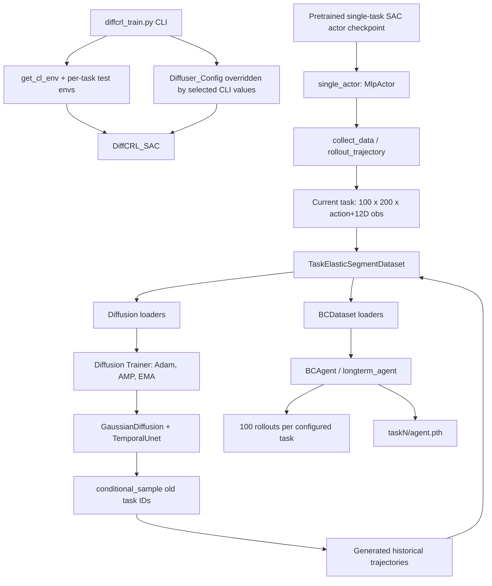
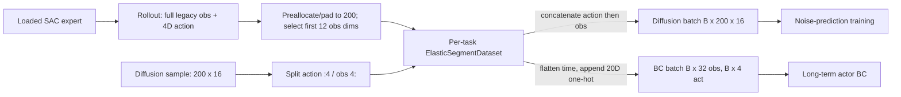

# Architecture of the Legacy DiffCRL Project

This document describes the repository as it exists in the inspected source tree. It is not a redesign and does not assume that code described by the DISTR paper exists here. Static inspection was performed without running training or evaluation.

## Evidence conventions

The following labels are used throughout:

- **Verified implementation** — directly supported by executable source in this repository.
- **Documented intention** — asserted by comments, docstrings, README text, or scripts, but not necessarily consistent with the executable path.
- **Inference** — a conservative interpretation of the code, explicitly identified as such.
- **Not implemented / not found** — no corresponding implementation was found in the inspected tree.

“Active DiffCRL path” means the path selected by `python diffcrl_train.py --cl_method=diffcrl`. Code that is importable but not reached from that path is described separately. Line references refer to the inspected revision.

## 1. Project Overview

### Purpose and scope

**Documented intention.** The repository describes itself as a PyTorch implementation of DiffCRL for diffusion-based continual reinforcement learning on Continual World. The conceptual division in [README.md](README.md) is:

1. train a separate short-term SAC policy for every task;
2. use each short-term policy to collect successful/high-quality fixed-length trajectories;
3. continually train a task-conditioned diffusion model to represent those trajectories;
4. train one long-term policy by behavior cloning (BC) from current-task trajectories and diffusion-generated historical trajectories.

The README calls these the **short-term policy** and **long-term policy**. The code uses `single_actor` for the loaded per-task actor and `longterm_agent` for the BC agent. No classes named `ImmediatePolicy` or `GeneralPolicy` exist. The short-term actor is the closest implementation analogue of an Immediate Policy, and `BCAgent` is the closest analogue of a General Policy.

**Verified implementation.** Single-task expert training is implemented by [run_single.py](run_single.py), using the PyTorch `SAC` class. The continual orchestration is implemented by `DiffCRL_SAC.run` in [continualworld/methods/diffcrl.py](continualworld/methods/diffcrl.py). It loads a pretrained actor for each task rather than training an SAC expert during the continual run. It creates a conditional temporal U-Net diffusion model and a separate BC policy.

**Important qualification.** Static inspection found multiple incompatible interfaces in the active DiffCRL path (Section 15). Consequently, the intended stage sequence is clear, but successful execution of the checked-in end-to-end continual path is **not verified**. The most immediate blockers include `.pt` versus `.pth` actor checkpoint naming, list-like `test_envs` being called as a single environment, and `BCAgent` treating the tuple returned by `MlpActor` as a distribution.

### Relationship to DISTR

The task context associates this project with “Stable Continual Reinforcement Learning via Diffusion-Based Trajectory Replay” (DISTR), but the paper itself is not present in the repository. The string `DISTR` does not occur in the inspected source or README. Therefore, claims about the paper are not reconstructed from memory. Section 14 limits its comparison to repository evidence and marks paper-side details as requiring external verification.

### Environments, tasks, and objective

The environment layer is a modified Continual World/MetaWorld integration. It imports legacy `gym` and a nonstandard `metaworld.MT10_KUKA()` constructor despite naming the resulting global object `MT50` ([continualworld/envs.py](continualworld/envs.py), lines 12–23). Task sequences are defined in [continualworld/tasks.py](continualworld/tasks.py): CW2, CW5, CW10, CF5, and CW20 (CW10 repeated twice). The code assumes:

- episode horizon: 200;
- action dimension: 4 (`MW_ACT_LEN`);
- a 12-dimensional “diffusible” observation prefix (`MW_OBS_LEN`);
- a legacy base observation of 39 dimensions in `DiffCRL_SAC` (`12 + (39 - 12)`), followed by task one-hot dimensions.

The single-task objective is standard entropy-regularized SAC. The continual objective actually optimized in `DiffCRL_SAC` is two independent supervised/generative objectives:

- diffusion noise prediction over complete 200-step `[action, observation-prefix]` sequences;
- maximum-likelihood BC of actions from observations for a persistent long-term actor.

The continual method does not perform SAC updates in `DiffCRL_SAC.run`; the base SAC actor and critics are explicitly deleted in `DiffCRL_SAC.__init__`.

## 2. Repository Structure

```text
.
├── diffcrl_train.py                 # DiffCRL CLI and object construction
├── run_single.py                    # single-task SAC expert pretraining
├── input_args.py                    # CLI defaults for both entry points
├── diffcrl/
│   └── bc_agent.py                  # persistent BC policy and helper routines
├── continualworld/
│   ├── envs.py                      # MetaWorld construction and CL/MT envs
│   ├── tasks.py                     # named task sequences
│   ├── methods/
│   │   └── diffcrl.py               # DiffCRL_SAC orchestration
│   ├── sac/
│   │   ├── sac_torch.py             # SAC optimization, evaluation, checkpoints
│   │   ├── models_torch.py          # MLP actor, critics, PopArt critic
│   │   ├── replay_buffers_torch.py  # FIFO/reservoir replay
│   │   └── utils/logx_torch.py      # legacy alternate logger module
│   ├── diffuser/
│   │   ├── config/default_config.py # diffusion defaults
│   │   ├── models/temporal.py       # conditional temporal U-Net
│   │   ├── models/diffusion.py      # Gaussian diffusion process
│   │   ├── models/helpers.py        # schedule, blocks, weighted losses
│   │   ├── datasets/sequence.py     # trajectory and BC datasets
│   │   └── utils/training.py        # optimizer, EMA, save/load
│   └── utils/
│       ├── wrappers.py              # one-hot, randomization, success wrappers
│       ├── run_utils.py             # method-to-class dispatch
│       ├── utils_torch.py           # seeds, activation and reset helpers
│       └── logx_torch.py            # active EpochLogger
├── examples/                        # command examples, some stale
├── scratch/render.py                # standalone checkpoint rendering helper
├── setup.py                         # incomplete package dependency declaration
└── logs/, videos/, *.pkl, *.npz     # checked-in experiment/config artifacts
```

### Module responsibilities and dependencies

| Module | Main symbols | Responsibility and dependencies |
|---|---|---|
| `diffcrl_train.py` | `main`, `generate_samples`, `load_diffusion*` | Resolves tasks, creates CL/test environments, SAC network kwargs, diffusion namespace, logger, and selected method. Calls `DiffCRL_SAC.run`. Several top-level helpers are unused by `main`. |
| `run_single.py` | `main` | Builds one one-hot-wrapped task and a base `SAC`; produces the experts expected by DiffCRL. |
| `input_args.py` | `cl_parse_args`, `single_parse_args`, `mt_parse_args` | CLI schema. Only the first two are used by present entry points. |
| `continualworld/methods/diffcrl.py` | `DiffCRL_SAC`, `cycle` | Constructs diffusion/BC components, collects expert trajectories, generates historical data, trains diffusion and BC concurrently, evaluates and saves BC. Inherits `SAC` primarily to reuse environment/device initialization; deletes its RL models. |
| `diffcrl/bc_agent.py` | `BCAgent`, `register_agent` | Creates a large `MlpActor`, Adam optimizer, nominal likelihood BC update, testing, and BC checkpoint save/load. Contains older hardcoded helper paths and shapes. |
| `continualworld/sac/sac_torch.py` | `SAC` | Full off-policy SAC loop used by `run_single.py`; its `run` method is overridden for DiffCRL. |
| `continualworld/sac/models_torch.py` | `MlpActor`, `MlpCritic`, `PopArtMlpCritic` | Tanh-squashed Gaussian actor, twin-Q-compatible critic, optional multi-head selection and PopArt. |
| `continualworld/sac/replay_buffers_torch.py` | `ReplayBuffer`, `ReservoirReplayBuffer`, `EpisodicMemory` | Transition replay. FIFO/reservoir are active in base SAC; not used by `DiffCRL_SAC.run`. |
| `continualworld/diffuser/models/temporal.py` | `TemporalUnet` | 1-D convolutional U-Net over the trajectory time axis, with attention and timestep/task embeddings. |
| `continualworld/diffuser/models/diffusion.py` | `GaussianDiffusion` | Cosine-schedule forward process, noise objective, ancestral reverse sampler. |
| `continualworld/diffuser/datasets/sequence.py` | `ElasticSegmentDataset`, `TaskElasticSegmentDataset`, `BCDataset`, `batch_cat` | Keeps per-task trajectories in memory and adapts them to diffusion or BC batches. `SegmentDataset` and `TopElasticSegmentDataset` are not used in the active path. |
| `continualworld/diffuser/utils/training.py` | `Trainer`, `EMA` | Adam + AMP training, EMA model, periodic diffusion checkpoints. |
| `continualworld/envs.py` | `get_single_env`, `get_cl_env`, `ContinualLearningEnv` | Builds old-Gym-style MetaWorld environments and appends task identity. |
| `continualworld/utils/wrappers.py` | `OneHotAdder`, `SuccessCounter`, `RandomizationWrapper` | Observation augmentation, episode-level success accumulation, reset randomization. |

The remaining `diffuser/datasets` and environment/rendering utilities appear inherited from a generic Diffuser codebase. D4RL loaders, normalizers, locomotion environments, renderers, and PyBullet utilities are not reached by the DiffCRL entry point.

## 3. System Architecture



### Component roles

- **Reinforcement-learning policy / short-term policy:** `MlpActor` trained by `SAC` in a separate `run_single.py` process. DiffCRL only loads it and rolls it out.
- **SAC:** active for expert pretraining and for the non-DiffCRL baseline. Its networks are not the long-term policy.
- **Long-term / General Policy analogue:** `BCAgent.actor`, a separate `MlpActor` with four 512-unit layers. It persists across stages and is optimized only by BC.
- **Immediate Policy analogue:** no named component. `single_actor`, loaded anew per stage from a per-task SAC checkpoint, serves this conceptual role.
- **Diffusion model:** `GaussianDiffusion(TemporalUnet)` over complete 200-step sequences; task identity is a one-hot condition supplied to the U-Net, not part of each generated transition.
- **Generative replay:** at every stage after the first, 100 trajectories are newly sampled for every previous task. Raw old-task trajectories are not retained by the orchestration code.
- **Continual task management:** an explicit Python `for train_stage in range(num_tasks)` in `DiffCRL_SAC.run`, rather than interaction-driven switching in `ContinualLearningEnv`.
- **Evaluation/checkpointing:** BC success is evaluated on every configured task after every stage; BC and diffusion have separate checkpoint systems.

## 4. End-to-End Training Pipeline

### Entry points and configuration

`diffcrl_train.py` parses `cl_parse_args`. It resolves either a named `TASK_SEQS` entry or `--task_list`, creates a `ContinualLearningEnv`, and creates one single-task test environment per sequence position. Each observation has the environment observation plus a sequence-position one-hot vector.

It builds actor/critic kwargs, then copies class attributes from `Diffuser_Config` into an `argparse.Namespace`. Only keyword names that also occur in `Diffuser_Config` are copied from the CLI. It then forcibly sets:

- `cond_dim = n_tasks`;
- `n_tasks = n_tasks` (note the config originally spells `n_task` singular);
- diffusion `observation_dim = 12`;
- `action_dim` from the environment (expected 4);
- `transition_dim = 12 + action_dim` (normally 16);
- checkpoint bucket to `<logger.output_dir>/diffusion`;
- loss type from `--diffusion_loss_type`.

Method dispatch in `get_sac_class` supports only `None` (base SAC) and `diffcrl`. Other method names accepted by the argument parser raise `NotImplementedError` because their PyTorch ports are commented out.

### Separate expert-pretraining flow

`run_single.py` creates a single wrapped environment for the selected task but makes the actor/critic multi-head count equal to the size of `--task_series`. Because `hide_task_id=True`, the networks drop all but the first 12 observation coordinates before their core networks. A multi-head network nevertheless selects an output head using the task one-hot stored at the end of the original observation.

Base `SAC.run` performs environment interaction, transition replay, gradient updates, evaluation and checkpointing (Section 5). These weights are intended to be consumed later by DiffCRL.

### Continual flow in `DiffCRL_SAC.run`

At construction, `DiffCRL_SAC` first constructs the complete base SAC and then deletes `actor`, both critics, and both target critics. It retains inherited environment metadata and replay/optimizer objects, although those are not used in its overridden `run`. It creates:

- one conditional temporal U-Net and Gaussian diffusion model;
- one `Trainer`, created when `run` begins;
- one `single_actor` with the configured SAC actor architecture (default four 256-unit layers);
- one persistent `BCAgent` (four 512-unit layers, Adam at `1e-4`).

For stage `s`:

1. Find the lexicographically first directory below `pretrained_direc/<task-name>/`.
2. Load a pretrained actor into `single_actor`.
3. Create a new in-memory `TaskElasticSegmentDataset` with empty per-task datasets.
4. For each prior task `j < s`, sample `n_trajectories` (default 100) complete trajectories from the current diffusion model conditioned on one-hot task `j`; split the first `action_dim` fields as actions and the remaining 12 as observations.
5. Roll out the current task’s `single_actor` up to `2 * n_trajectories` times, preferentially accepting trajectories whose final `info['success']` is true. Trajectories are preallocated to length 200 and remain zero-padded after early termination.
6. Retain only the first 12 coordinates from current observations for both diffusion and BC datasets.
7. Build per-task diffusion loaders (batch 32) and BC loaders (stage-dependent batch size).
8. Start two Python threads: one trains diffusion; one trains the persistent BC agent. Both consume the fixed stage-start dataset; BC does not consume samples generated by the concurrently updated diffusion model.
9. Save BC actor and optimizer to `<run>/task<s>/agent.pth`.
10. Test the BC agent on every task for 100 episodes each and append success rates to a working-directory JSON file.
11. Write a stage timing JSON file, copy diffusion EMA weights into the online diffusion model, discard stage datasets/loaders, and continue.

The diffusion model, its optimizer/scaler/EMA, and BC actor/optimizer persist across stages. `single_actor` weights are overwritten by the next expert. Stage datasets do not persist. The diffusion trainer’s `step` is cumulative; stage training budgets are 100,000 calls for stage 0 and 20,000 for every later stage.

### Implemented-procedure pseudocode

```text
tasks <- configured sequence
make CL env and one single-task test env per sequence position
make conditional diffusion model D and EMA trainer T
make reusable expert actor E
make persistent BC actor G

for stage s = 0 .. number_of_tasks-1:
    E <- load first discovered pretrained actor for tasks[s]
    stage_data <- empty per-task datasets

    for old task j = 0 .. s-1:
        generated <- D.sample(task_one_hot=j, count=100, horizon=200)
        stage_data[j] <- generated [actions (4), observations (12)]

    current <- collect up to 100 preferred-success rollouts from E on task s
    stage_data[s] <- [current actions, first 12 observation coordinates]

    concurrently:
        train D on current + sampled subsets of old task datasets
        train persistent G by BC on up to 3 selected task datasets per update

    save G and its optimizer
    evaluate G on all configured tasks
    D.online_parameters <- D.EMA_parameters
```

### Verified execution discontinuities

The above is the operation order encoded by `run`, not proof it completes. At least these discontinuities occur before or during the first stage in the inspected revision:

- base SAC saves `actor.pt`; `load_actor_model` looks for `actor.pth`;
- `self.test_envs` is constructed as a Python list, but `rollout_trajectory` calls `self.test_envs.set_task(...)` and `self.test_envs.step(...)`;
- `BCAgent.update` expects `self.actor(obs)` to have `.log_prob`, but `MlpActor.forward` returns `(mu, log_std, pi, logp_pi)`;
- `BCAgent.act` likewise expects `.mean`/`.sample` on that tuple.

No experiment was run to determine which blocker is encountered first for a particular local setup.

## 5. Reinforcement Learning Implementation

### Actor

`MlpActor` receives the full observation tensor but, with the defaults used by both entry points, sets its MLP input dimension to `MW_OBS_LEN = 12`. Its default CLI architecture is four fully connected layers of 256 units. `mlp` applies layer normalization only after the first linear layer; when enabled it uses `Tanh` there regardless of configured activation. Subsequent layers use the configured activation (`lrelu` by default). The actor has separate linear heads for Gaussian mean and log standard deviation.

For `H` heads and action dimension `A`, each head layer emits `A*H` values. `_choose_head` reshapes this to `[B, A, H]` and multiplies by the final `H` observation coordinates as a one-hot selector. `log_std` is clamped to `[-20, 2]`. A reparameterized Normal sample is drawn, its Gaussian log likelihood calculated, and both mean/sample are squashed by `tanh`; the log probability receives the standard change-of-variables correction. The actor returns four tensors of shapes `[B,A]`, `[B,A]`, `[B,A]`, and `[B]`.

The environment action bound is asserted equal across dimensions, but the actor only returns `tanh` values in `[-1,1]`; it does not multiply by `action_space.high`. This is correct only when the environment’s required bounds are `[-1,1]`.

### Critics and targets

Two independent `MlpCritic` instances receive observation and action. With `hide_task_id=True`, each critic uses the first 12 observation values concatenated with the 4-D action. Its MLP mirrors the actor hidden sizes and produces one scalar per head. Task one-hot selection is applied in the same way. Target critics are deep copies and are updated after every gradient call:

\[
\bar\theta \leftarrow (1-\rho)\theta + \rho\bar\theta, \qquad \rho=0.995.
\]

`PopArtMlpCritic` exists but is not selected by either present entry point.

### SAC losses

For replay transition `(s,a,r,s',d)`, the target is:

\[
y=r+\gamma(1-d)\left[\min_i \bar Q_i(s',a')-\alpha\log\pi(a'|s')\right],
\quad a'\sim\pi(\cdot|s').
\]

Each critic minimizes `0.5 * mean((y-Q_i(s,a))^2)`. The actor minimizes:

\[
L_\pi=\mathbb E[\alpha\log\pi(a|s)-\min_i Q_i(s,a)].
\]

With `alpha=auto`, the implementation owns one scalar `log_alpha` per task. It selects values with the task one-hot and minimizes

\[
L_\alpha=-\mathbb E[\log\alpha(\log\pi+\mathcal H_{target})].
\]

The target entropy is `-action_dim` unless `target_output_std` is set; CLI default `0.089` instead computes action-dimension times the differential entropy of a Normal with that standard deviation.

### Replay and schedule

The FIFO buffer stores NumPy arrays for observation, next observation, action, reward and terminal flag, sampling uniformly with replacement. The reservoir variant performs standard stream reservoir insertion. Default capacity is 1,000,000 and minibatch size is 128.

Base SAC uses 10,000 initial random-action steps per task (`current_task_timestep > start_steps`, so policy use begins after the strict inequality), waits until task step 1,000, then every 50 environment steps performs 50 gradient updates. Time-limit terminals are stored as nonterminal. On task changes, CLI defaults reset FIFO replay and optimizer state; critics are retained unless requested. Actor weights persist. `clipnorm` is accepted and stored but no gradient clipping appears in `update_gradients`.

Default actor/critic/alpha optimizers are Adam at `1e-3`; discount is `0.99`. Logging defaults every 40,000 steps. Checkpoint saving defaults every 100 logging epochs and at the final step.

### SAC checkpointing and DiffCRL interaction

`save_model` stores only network state dictionaries: `actor.pt`, `critic1.pt`, `critic2.pt`, and both target critics. Optimizer, replay, alpha and counters are not saved. `load_model` is internally inconsistent with that writer: it looks for `.pth` files. DiffCRL has the same `.pth` expectation. Thus the expert producer/consumer contract is not consistent in the inspected revision.

The inherited SAC replay, losses and target updates are **not invoked** by `DiffCRL_SAC.run`. SAC matters to the DiffCRL design only as the separate producer of expert actors.

## 6. Policy Architecture and Behavior Cloning

### Separation and initialization

There are separate model instances:

- `single_actor`: `MlpActor` using CLI SAC settings (default `[256,256,256,256]`, task-count heads, hidden task input). It is initialized once and then reloaded from the current task’s expert checkpoint each stage.
- `longterm_agent.actor`: `MlpActor` created by `register_agent` with `[512,512,512,512]`, leaky-ReLU, layer normalization, `hide_task_id=True`, and default `num_heads=1`. It starts randomly and persists across stages.

They share neither parameters nor optimizer state. The long-term actor has a single output head. Although BC inputs contain task one-hot fields, `hide_task_id=True` means only the first 12 observation coordinates reach its network. Therefore, **verified implementation:** the long-term policy is not explicitly task-conditioned. It can only infer task from the 12-D state prefix. This also means the extra one-hot fields constructed by `BCDataset` do not affect its prediction.

### Intended BC objective

`BCAgent.update` is written as negative log likelihood:

\[
L_{BC}=-\frac{1}{B}\sum_b \log\pi_\phi(a_b|o_b).
\]

It uses Adam at `1e-4`. `BCAgent.save` stores actor and optimizer state, enabling policy/optimizer continuation across stages; `load` restores both.

**Interface mismatch:** the current `MlpActor` does not return a PyTorch distribution. It returns four tensors. Therefore the `.log_prob` call in this objective is not executable against the actor class imported by `bc_agent.py`. The exact BC loss actually achieved by a successful run cannot be verified from this revision. There is no alternative active MSE BC path.

### Dataset mixing

`BCDataset` flattens `[N,200,D]` observations/actions into independent transitions. It appends a hardcoded default 20-dimensional one-hot area and sets one task coordinate. No trajectory boundary, time, reward, or terminal is passed to BC.

At stage 0, the current-task loader is traversed for 300 epochs. At later stages, there are 300 epochs of 466 update iterations (`200*100//43 + 1`). Each update selects without replacement up to three tasks uniformly from all tasks seen so far, obtains one batch from each, concatenates them, and performs one update. The current task is not guaranteed to appear in a given update. This is uniform task sampling, not priority sampling. Batch size is 128 at stage 0, 64 at stage 1, and 43 later, so concatenating three later-stage task batches yields at most 129 examples.

Current and historical data are not concatenated into one stored dataset; they remain per-task loaders and are mixed at optimization time. Historical BC data are diffusion-generated; current BC data come from expert rollouts.

### Action at evaluation

`BCAgent.test` calls `act(obs, False)`, which according to `act` requests a sampled rather than mean action. Thus the intended BC evaluation is stochastic. The current tuple/distribution mismatch prevents that method from executing as written.

## 7. Diffusion Model Architecture

### Representation and shapes

For normal MetaWorld assumptions:

| Tensor | Shape | Meaning |
|---|---:|---|
| diffusion trajectory `x_0` | `[B, 200, 16]` | first 4 action values, then first 12 observation values |
| task condition | `[B, n_tasks]` | one-hot sequence position/task ID |
| diffusion time | `[B]` | integer in `[0,1999]` during training/sampling |
| U-Net internal input | `[B,16,200]` | trajectory transposed to channels-first |
| sampled history | `[100,200,16]` by default | complete synthetic state-action sequences |
| optional returned chain | `[B,2001,200,16]` | initial noise plus every reverse step; requested by active generation |

The active generator requests `return_diffusion=True` and then discards the returned chain. With default 2,000 diffusion steps this is a potentially very large temporary tensor.

### Temporal U-Net

`TemporalUnet` uses base width 128 and `dim_mults=(1,4,8)`, giving channel transitions `16→128→512→1024`. At each down level it applies two residual temporal blocks, residual pre-normalized four-head linear attention, and (except the final level) stride-2 downsampling. The middle has residual block, attention, residual block. Two up levels concatenate skip features, apply two residual blocks plus attention, and upsample except at the final up level. A final convolutional block and 1×1 convolution return 16 channels.

Each residual block is two padded Conv1d–GroupNorm(8)–Mish blocks. A projected conditioning embedding is added after the first convolution. Diffusion timestep conditioning is a sinusoidal embedding followed by `128→512→128`. Task conditioning is `n_tasks→128→512→128`. The two 128-D embeddings are concatenated, so residual blocks receive a 256-D conditioning vector.

Although `condition_dropout=0.25` and `condition_guidance_w=1.0` are configured, condition dropout and conditional/unconditional guidance code are commented out. Sampling makes a single conditional prediction. Therefore classifier-free guidance is **not implemented in the active code**.

### Forward diffusion

`cosine_beta_schedule` builds 2,000 beta values from the cosine cumulative-alpha schedule with `s=0.008`, clipped to `[0,0.9999]`. For uniformly sampled timestep `t`:

\[
x_t=\sqrt{\bar\alpha_t}x_0+\sqrt{1-\bar\alpha_t}\epsilon,
\qquad \epsilon\sim\mathcal N(0,I).
\]

The default `predict_epsilon=True`, so the U-Net predicts noise. `p_losses` compares the output with the exact sampled noise.

### Objective and weights

CLI default `--diffusion_loss_type=l2` overrides the config class default `l1`; example DiffCRL commands explicitly use `l1`. Both are elementwise weighted losses. With defaults `loss_discount=1`, `action_weight=1`, and no observation overrides, every time/dimension receives weight one. Thus the active default is ordinary mean squared noise error; example scripts make it mean absolute noise error.

Formally, with weight matrix `w` of shape `[200,16]`:

\[
L_D=\operatorname{mean}_{b,h,d}\left[w_{h,d}\,\ell(\epsilon_\theta(x_t,t,c)_{b,h,d},\epsilon_{b,h,d})\right].
\]

The reported `a0_loss` covers only action dimensions at trajectory timestep zero. Despite the name `action_weight`, the implementation assigns that value to action dimensions at **all** horizon positions.

### Optimization and EMA

`Trainer` uses Adam at `2e-5`, CUDA AMP `autocast` and `GradScaler` unconditionally enabled, and two gradient-accumulation batches per optimizer call. In `DiffCRL_SAC.diffusion_train`, each of those batches is itself a concatenation of current task plus one, two, or three historical task batches depending on stage. At most four tasks contribute to one accumulated batch.

EMA decay is `0.995`, updated every 10 optimizer calls. Before global step 2,000 the EMA is reset to online parameters at update points. At each stage end, `reverse_reset_parameters` replaces online parameters with EMA parameters. The optimizer state is not reset, so its moments then correspond to the pre-copy online trajectory—an implementation detail relevant to continuation.

### Reverse process and postprocessing

The model reconstructs

\[
\hat x_0=\frac{x_t}{\sqrt{\bar\alpha_t}}-sqrt{\frac{1}{\bar\alpha_t}-1}\,\epsilon_\theta(x_t,t,c),
\]

clips every action and observation coordinate of `x_0` to `[-1,1]`, computes the standard DDPM posterior mean/variance, and samples from timestep 1,999 down to 0. No extra noise is added at `t=0`. This is ancestral DDPM sampling, not DDIM.

There is no conditioning on initial state, no dynamics-consistency filter, no reward/return guidance, no action postprocessing beyond global denoised clipping, and no normalization/unnormalization in the active pipeline. Generic normalizer modules exist but are not imported by `diffcrl_train.py` or `diffcrl.py`.

### Continual maintenance and checkpoints

One diffusion model is updated through all stages. Old raw trajectories are replaced by samples from the model as it existed at the stage boundary. Periodic checkpoints contain `step`, online `model`, `ema`, and AMP `scaler`, but not Adam optimizer state. The resume helper loads those fields into an already-created trainer, also without restoring optimizer state.

## 8. Trajectory Representation and Data Pipeline



### Collection and selection

`rollout_trajectory` allocates zero arrays of `[200, 39+n_tasks]` and `[200,4]`. It records the observation before every action, stops on environment `done` or 200 steps, and returns cumulative reward plus the final step’s `info['success']`. Reward and success are used only for metadata/selection; they are not placed in the diffusion dataset.

`collect_data` attempts at most `2*N` rollouts to collect `N`. It accepts successes immediately. Its fallback condition, `iter_idx - success_count >= N - 1`, begins accepting failures once sufficiently many unsuccessful attempts have occurred. This is not top-return selection and does not sort by episode reward. `total_episode_reward` is returned but discarded by `run`. Because success is read only from the final `info`, an environment that reports transient success but not final-step success can be treated as unsuccessful here, unlike `SuccessCounter`, which ORs success across an episode.

### Padding and temporal semantics

Early-ending trajectories are right-padded with zeros in both state and action. No mask or length accompanies them, so diffusion and BC treat padded rows as genuine data. Full-horizon TimeLimit episodes have no padding. No train/validation split is constructed.

`ElasticSegmentDataset` stores float32 NumPy arrays. Its diffusion item concatenates action before observation and attaches one task condition per full trajectory. `BCDataset` flattens all time points. Data exist only in process memory during a stage; the orchestrator does not save trajectory datasets.

### Task identity and dimensions

The diffusion condition is the sequence index, not necessarily a unique semantic environment: CW20 repeats the same ten task names but assigns 20 distinct one-hot IDs. Current environment observations also contain a position-specific one-hot. Only the first 12 coordinates enter diffusion or the long-term actor.

`BCDataset` defaults to 20 task columns regardless of the configured number of tasks because callers do not pass `n_tasks`. Since the long-term actor discards everything after coordinate 12, these fields are currently ineffective. If task identity were exposed to the actor, this hardcoding would become a dimensional incompatibility.

### Normalization

**Not implemented in the active path.** Raw expert observations/actions are fed to diffusion. Generated `x_0` is clipped to `[-1,1]`. `continualworld/diffuser/datasets/normalization.py` contains reusable normalizers, but neither active dataset calls them. This means the code implicitly assumes the modeled 12-D observation prefix is appropriately scaled, an assumption not established in this repository.

## 9. Continual Learning and Replay Mechanism

The active continual schedule is explicit and stage-based. Expert policies are external prerequisites and old environments/expert policies are not accessed after their own stage. At each new stage:

- the current expert supplies 100 new real trajectories;
- the diffusion model supplies 100 newly generated trajectories for each old sequence position;
- the prior stage’s raw current trajectories are no longer present;
- both diffusion and BC train from this reconstructed per-task collection;
- both models retain parameters across stages.

### Replay allocation

Each per-task stage dataset has the same intended trajectory count, 100. Diffusion optimization always includes a current-task batch and samples up to three distinct prior tasks uniformly. BC optimization samples up to three distinct tasks uniformly from current plus history. Hence task-level allocation is approximately balanced but capped per update; it is not proportional to returns, success, uncertainty, forgetting, age, or dataset priority.

`weights = np.array([1] * num_tasks)` is constant in both training functions. No code updates it. `TopElasticSegmentDataset`, which can retain high-return trajectories using a heap, is present but unused. **Prioritized replay as a DISTR mechanism is not found in the active implementation.** The only prioritization-like behavior is the current expert collector’s preference for successful episodes.

### Generative recursion

The diffusion model is trained continually on current real trajectories plus its own samples for old tasks. This is generative replay of full state-action sequences. Because old samples are regenerated from the boundary model and then the model is further trained, historical distributions can recursively depend on earlier generations. No real episodic memory protects old tasks in the active path.

The long-term actor is independently continual: it keeps weights and Adam moments and receives current plus generated historical state-action pairs. It is never initialized from `single_actor` and never receives an SAC objective.

## 10. Environment and Benchmark Integration

### Legacy API and wrappers

The code expects old Gym semantics:

- `reset()` returns observation only;
- `step()` returns `(observation, reward, done, info)`;
- `gym.wrappers.TimeLimit` supplies `TimeLimit.truncated`;
- environments expose internal fields such as `_freeze_rand_vec`, `_random_reset_space`, and `_last_rand_vec`.

`RandomizationWrapper` supports deterministic, all-random, fixed-20-task, and small-box reset modes. Active constructors default to `random_init_all`. `OneHotAdder` appends the configured sequence-position vector. `SuccessCounter` records whether any step in a completed episode reported success.

### Task construction

`get_mt50()` temporarily sets NumPy seed 1 and constructs `metaworld.MT10_KUKA()`. That constructor is not part of standard modern MetaWorld APIs and indicates a custom/legacy dependency. Despite local names `MT50` and `MT50_TASK_NAMES`, the actual object comes from `MT10_KUKA`.

All single and continual environments are limited to 200 steps. `ContinualLearningEnv` advances tasks after exactly `steps_per_env` interactions, potentially truncating a boundary episode. This mechanism is active for base continual SAC but is mostly bypassed by the stage-driven DiffCRL method, which rolls out separate test environments.

### MetaWorld v3 compatibility assumptions

Confirmed source assumptions that must be considered during comparison (without proposing migration changes) are:

- nonstandard `MT10_KUKA` constructor and legacy `train_classes`/`train_tasks` access;
- old Gym reset/step signatures;
- hardcoded action dimension 4 and modeled observation prefix 12;
- hardcoded legacy full observation base dimension 39 in `DiffCRL_SAC`;
- direct access to MetaWorld private reset-randomization fields;
- success expected at `info['success']`;
- task identity appended at the tail of observations;
- fixed 200-step horizon and zero padding;
- equality checks over selected observation-space bounds.

The exact MetaWorld package revision is not pinned in `setup.py`, and its Git dependency is commented out. Consequently, the exact reward functions, observation meanings and task implementations cannot be established from this repository alone.

## 11. Configuration and Hyperparameters

### Main CLI defaults

| Parameter | Default | Active meaning |
|---|---:|---|
| `tasks` | `CW5` | named sequence |
| `seed` | `None` | passed to SAC seed utility; PyTorch accepts `None` poorly in some APIs, runtime unverified |
| `steps_per_task` | 1,000,000 | CL environment budget; not used to train experts inside DiffCRL |
| `log_every` | 40,000 | base SAC evaluation interval; largely unused by overridden DiffCRL run |
| `save_freq_epochs` | 100 | base SAC network save interval; unused by DiffCRL BC saves |
| `replay_size` | 1,000,000 | base SAC buffer allocated even for DiffCRL, then unused |
| `batch_size` | 128 | base SAC batch; diffusion/BC use their own constants/config |
| `hidden_sizes` | 256×4 | expert/single actor and base SAC networks |
| `activation` | leaky ReLU | actor/critic core |
| `use_layer_norm` | true | first MLP layer only |
| `lr` | 1e-3 | SAC optimizers |
| `gamma` | 0.99 | SAC discount |
| `alpha` | `auto` | per-task entropy tuning |
| `target_output_std` | 0.089 | alternate target entropy derivation |
| `multihead_archs` | true | one actor/critic output head per sequence position |
| `hide_task_id` | true | MLP core reads first 12 observation values |
| `update_after` | 1,000 | SAC warmup before updates |
| `update_every` | 50 | SAC update interval and number of updates |
| `diffusion_loss_type` | `l2` | overrides config class `l1` |

Numerous parsed CL-method arguments are inactive because only base SAC and `diffcrl` are dispatched. `n_train_steps`, `n_steps_per_epoch`, and `diffusion_bc_coef` happen to match config attribute names and are copied into the diffusion namespace, but `diffusion_train` overwrites `n_train_steps` per stage and `diffusion_bc_coef` is never consumed by the active method.

### Diffusion defaults

| Parameter | Value | Source/use |
|---|---:|---|
| horizon | 200 | config; collection and generation |
| diffusion steps | 2,000 | config; training/sampling |
| base U-Net width | 128 | config |
| width multipliers | `(1,4,8)` | config |
| task condition | enabled | config |
| condition dropout | 0.25 | configured, implementation commented out |
| guidance weight | 1.0 | configured, guidance implementation commented out |
| denoised clipping | true | all generated dimensions clipped `[-1,1]` |
| trajectories/task/stage | 100 | config |
| diffusion batch/task | 32 | file-level constant/config agree |
| diffusion Adam LR | 2e-5 | config |
| gradient accumulation | 2 | config |
| EMA decay | 0.995 | config |
| stage 0 updates | 100,000 | hardcoded in `diffusion_train` |
| later stage updates | 20,000 | hardcoded in `diffusion_train` |
| checkpoint interval | 10,000 | config |

### BC defaults

The BC actor is hardcoded to four 512-unit layers, leaky-ReLU, layer normalization, Adam `1e-4`, and 300 epochs per stage. BC batch sizes are hardcoded by stage as `[128,64,43,...]`. File-level `bc_batch_size`/`bc_num_epochs` constants are shadowed or superseded in methods.

### Seeds and experiment scripts

Base `SAC.__init__` calls the repository seed utility, so constructing `DiffCRL_SAC` also seeds before its SAC networks are deleted. `diffcrl_train.py` defines another `set_seed` but its call is commented out. No deterministic DataLoader generator is supplied.

Examples explicitly request L1 diffusion loss. Several example scripts invoke missing `run_cl.py` and unsupported methods; they are stale relative to this tree. `pretrained_direc` is a hardcoded `./continual_diff/logs/pretrained_cw10`, which differs from the README’s normal `./logs/...` examples and is not CLI-configurable.

## 12. Evaluation and Metrics

### Base SAC

At every logging epoch, base SAC evaluates every test environment using:

- 10 stochastic episodes by default;
- 1 deterministic episode by default;
- return and episode length per task/mode;
- success rate per task/mode from `SuccessCounter`;
- overall average success across collected episode-success booleans.

Training logs also include return, length, Q statistics, losses, log probability, alpha, active environment and wall time. No explicit forgetting, forward transfer, backward transfer, or continual evaluation matrix calculation exists.

### DiffCRL long-term policy

After every stage, `BCAgent.test` attempts 100 stochastic episodes on every configured task and returns mean success. Results form one comma-separated row per stage in `bc_<timestamp>_testing.json`, which could be interpreted externally as a stage-by-task matrix. The repository does not compute summary continual-learning metrics from it. Episode returns are accumulated locally but neither returned nor logged.

Evaluation includes future/unseen tasks because the loop always covers `range(num_tasks)`, not only tasks `<= train_stage`. In CW20, repeated task names have distinct wrappers/one-hot positions, although the BC actor hides the one-hot.

**Implementation issue:** `BCAgent.test` depends on the incompatible `act` method described above. Also, `SuccessCounter` records a success only when `done` occurs; the test loop stops at length 200 as an alternative, but the wrapped `TimeLimit` should normally set `done` there under the expected old API.

### Checkpoint selection

Base SAC evaluates periodically but always saves on frequency/final criteria, not best performance. DiffCRL saves every stage. No validation-based checkpoint selection is implemented.

## 13. Checkpoints and Experiment Artifacts

| Artifact | Contents | Path convention |
|---|---|---|
| base SAC checkpoint | five network `state_dict`s; no optimizers/counters/replay/alpha | `<log>/checkpoints[/taskN]/{actor,critic1,critic2,target_critic1,target_critic2}.pt` |
| BC checkpoint | actor state + Adam state | `<DiffCRL log>/taskN/agent.pth` |
| diffusion checkpoint | step, online model, EMA model, AMP scaler; no Adam state | `<DiffCRL log>/diffusion/<ml_logger prefix>/checkpoint/state_<step>.pt` |
| SAC logs | TSV/progress, TensorBoard depending logger implementation/use | logger output directory |
| DiffCRL results | comma-separated success rows and timing dict despite `.json` suffix | current working directory |
| config pickles | constructor configuration emitted by `diffuser_utils.Config` | hardcoded repository-relative `diffusion_backbone.pkl`, `diffusion_config.pkl`, `trainer_config.pkl` |

`EpochLogger` in `diffcrl_train.py` is created without the CLI config, unlike `run_single.py`, so a DiffCRL run does not use that logger’s normal config capture at construction.

Resume is not a general interface. `DiffCRL_SAC.run` hardcodes `start_task=0`; changing source to a nonzero value activates placeholder paths (`./continual_diff/xx.pt`, `./continual_diff/logs/xx.pth`). Diffusion loading omits Adam state. Stage datasets are not saved. Therefore exact training resume is not implemented. Evaluation requires reconstructing the correct actor architecture and environment wrappers; `scratch/render.py` is a separate specialized helper, not a general evaluation entry point.

Checked-in `.pkl`, `.pt`, `.npz`, log and video files are experiment artifacts, not inputs selected by the active CLI except when a user manually points/hardcodes code to them.

## 14. Differences from the Original DISTR Paper

The paper is unavailable in this repository, so its details require external verification. The table deliberately avoids asserting paper behavior. “Legacy repository” is fully source-grounded.

| Aspect | Original DISTR Paper | Legacy Repository | Evidence |
|---|---|---|---|
| Immediate Policy training | Requires external verification | Separate single-task SAC pretraining; continual run loads experts and does not train SAC | `run_single.py`; `DiffCRL_SAC.run` |
| General Policy training | Requires external verification | Persistent `BCAgent`, intended negative log-likelihood BC only; no RL loss | `bc_agent.py:BCAgent.update` |
| SAC implementation | Requires external verification | Twin critics, tanh Gaussian actor, automatic per-task alpha, FIFO/reservoir replay | `sac_torch.py`, `models_torch.py` |
| Diffusion model | Requires external verification | Conditional 1-D temporal U-Net DDPM; 2,000 cosine steps; full 200-step sequence generation | `temporal.py`, `diffusion.py`, default config |
| Trajectory representation | Requires external verification | `[action(4), observation-prefix(12)]`; no reward, terminal, length or return | `sequence.py`, `diffcrl.py` |
| Task conditioning | Requires external verification | One-hot condition in diffusion; long-term actor hides task ID | `TemporalUnet.forward`; `register_agent` |
| Historical replay | Requires external verification | Regenerate 100 trajectories per old task each stage; no retained raw history | `DiffCRL_SAC.run` |
| Prioritized replay | Requires external verification | Not found. Uniform constant task weights; unused top-return dataset exists | `diffusion_train`, `bc_train`, `TopElasticSegmentDataset` |
| Policy initialization | Requires external verification | BC actor random once and continued; never copied from current expert | `DiffCRL_SAC.__init__` |
| Continual procedure | Requires external verification | Current expert collection → old diffusion generation → concurrent diffusion/BC training → evaluation → online model replaced by EMA | `DiffCRL_SAC.run` |
| Evaluation protocol | Requires external verification | Intended 100 stochastic BC episodes on all tasks after every stage; only success row logged | `BCAgent.test`, `DiffCRL_SAC.run` |

Additional repository-specific deviations from the README-level algorithm are material: the active interfaces are currently inconsistent, no high-return ranking is used despite “high-return trajectory distributions” in README prose, and configured classifier-free guidance is commented out.

## 15. Implementation Assumptions and Limitations

### Confirmed by static inspection

1. **End-to-end DiffCRL interface mismatches.** `.pt/.pth`, list/environment calls, and tuple/distribution BC interfaces prevent considering the active run executable as written.
2. **Hardcoded legacy dimensions.** Diffusion uses 12 observation fields and 4 actions; full observation allocation assumes `39+n_tasks`; BC appends 20 task fields.
3. **No active data normalization.** Raw real inputs train the diffusion model, while denoised output is clipped globally to `[-1,1]`.
4. **No prioritized replay.** Sampling weights are constant ones. The high-return heap dataset is unused.
5. **No stored real history.** Old data are generated anew at every stage.
6. **Padding is unmasked.** Early termination produces zero rows optimized as data.
7. **Long-term policy is task-agnostic by input.** It discards task one-hot coordinates.
8. **Configured guidance is inactive.** Dropout and conditional/unconditional combination are commented out.
9. **Large reverse-chain allocation.** Generation asks for and discards all intermediate states.
10. **Resume is incomplete.** Placeholder source edits are required; diffusion optimizer and datasets are absent from checkpoints.
11. **Checkpoint producer/loader mismatch.** SAC writer uses `.pt`, loaders use `.pth`.
12. **Stale CLI breadth.** Many accepted `cl_method` values cannot be dispatched in this PyTorch tree.
13. **External expert dependency.** Continual training cannot bootstrap itself; hardcoded expert root must already contain compatible runs.
14. **First lexicographic run selection.** `fetch_model_path` does not select latest or best expert.
15. **Concurrent training has no exchange.** BC and diffusion train in threads from the same frozen stage dataset; new diffusion improvements affect only later stages.
16. **EMA/optimizer discontinuity.** Online diffusion weights are overwritten by EMA at stage boundaries without resetting Adam moments.
17. **Success-selection semantics differ.** Expert collection tests final `info['success']`; evaluation wrapper accumulates any success in the episode.
18. **Dependencies are incomplete/unpinned.** `setup.py` omits Torch, Gym, MetaWorld, einops, ml_logger and others needed by imports; the MetaWorld dependency is commented.

### Hypotheses requiring runtime testing

- Raw observation scale plus `[-1,1]` clipping may distort generated trajectories; actual impact depends on the custom MetaWorld observation distribution.
- Recursive generative replay may accumulate model error across tasks; static inspection cannot quantify it.
- A task-agnostic 12-D BC actor may or may not infer task sufficiently from state.
- Threaded GPU training may cause resource pressure or nondeterminism; actual behavior depends on hardware/library versions.
- Repeating semantically identical tasks with separate diffusion condition IDs in CW20 may help or harm retention; no implemented metric answers this.
- The temporal U-Net’s fixed horizon and down/up dimensions are compatible with 200 in source structure, but runtime tensor compatibility was not executed under the task constraints.

## 16. Important Source Code References

| Component | File | Class / Function | Responsibility |
|---|---|---|---|
| continual entry | `diffcrl_train.py:83` | `main` | Tasks, environments, configs, dispatch |
| expert entry | `run_single.py:14` | `main` | Single-task SAC construction |
| CLI | `input_args.py:8` | `cl_parse_args` | Continual/DiffCRL defaults |
| CLI | `input_args.py` | `single_parse_args` | Expert-training defaults |
| method dispatch | `continualworld/utils/run_utils.py` | `get_sac_class` | Only base SAC and DiffCRL supported |
| DiffCRL construction | `continualworld/methods/diffcrl.py:39` | `DiffCRL_SAC.__init__` | Diffusion, expert actor, BC actor |
| collection | `continualworld/methods/diffcrl.py:138` | `rollout_trajectory` | Fixed-horizon expert rollout |
| selection | `continualworld/methods/diffcrl.py:176` | `collect_data` | Success-preferred trajectory collection |
| diffusion continuation | `continualworld/methods/diffcrl.py:191` | `diffusion_train` | Current/uniform-history batch mixing |
| policy continuation | `continualworld/methods/diffcrl.py:218` | `bc_train` | Persistent long-term BC |
| stage loop | `continualworld/methods/diffcrl.py:237` | `run` | Full intended continual pipeline |
| BC agent | `diffcrl/bc_agent.py:59` | `BCAgent` | Actor, optimizer, BC/eval/checkpoint |
| SAC | `continualworld/sac/sac_torch.py:22` | `SAC` | Expert RL implementation |
| SAC losses | `continualworld/sac/sac_torch.py:242` | `update_gradients` | Critic, actor, alpha, targets |
| SAC loop | `continualworld/sac/sac_torch.py:519` | `run` | Interaction and replay schedule |
| SAC checkpoint | `continualworld/sac/sac_torch.py:447` | `save_model` | Network-only state dictionaries |
| actor | `continualworld/sac/models_torch.py:90` | `MlpActor` | Squashed Gaussian multi-head policy |
| critic | `continualworld/sac/models_torch.py:152` | `MlpCritic` | Multi-head Q network |
| replay | `continualworld/sac/replay_buffers_torch.py:8` | `ReplayBuffer` | FIFO transition replay |
| diffusion | `continualworld/diffuser/models/diffusion.py:15` | `GaussianDiffusion` | DDPM loss and ancestral sampler |
| backbone | `continualworld/diffuser/models/temporal.py:122` | `TemporalUnet` | Conditional temporal denoiser |
| schedule/loss | `continualworld/diffuser/models/helpers.py:93,114` | `cosine_beta_schedule`, `WeightedLoss` | Noise schedule and weighted errors |
| stage dataset | `continualworld/diffuser/datasets/sequence.py:78` | `TaskElasticSegmentDataset` | Per-task trajectory datasets |
| trajectory dataset | `continualworld/diffuser/datasets/sequence.py:104` | `ElasticSegmentDataset` | `[action,obs]` diffusion records |
| BC adapter | `continualworld/diffuser/datasets/sequence.py:89` | `BCDataset` | Flatten trajectories to transitions |
| diffusion trainer | `continualworld/diffuser/utils/training.py:40` | `Trainer` | Adam, AMP, EMA, checkpointing |
| configuration | `continualworld/diffuser/config/default_config.py:13` | `Diffuser_Config` | Diffusion/model defaults |
| environment factory | `continualworld/envs.py:49,152` | `get_single_env`, `get_cl_env` | Wrapped task construction |
| CL environment | `continualworld/envs.py:94` | `ContinualLearningEnv` | Interaction-budget task switching |
| wrappers | `continualworld/utils/wrappers.py` | `OneHotAdder`, `SuccessCounter`, `RandomizationWrapper` | Task ID, success, reset variants |
| task sequences | `continualworld/tasks.py:1` | `TASK_SEQS` | CW/CF order definitions |

## 17. Open Questions and Unverified Details

1. Which exact custom MetaWorld revision provides `MT10_KUKA`, what its 39 observation fields mean, and their numeric ranges.
2. Whether this revision is an incomplete port and another missing actor class was intended for `BCAgent`’s distribution API.
3. Whether historical experiment checkpoints were produced before the `.pt/.pth` naming divergence, or by uncommitted code.
4. Which `ml_logger` prefix is used at runtime and therefore the exact nested diffusion checkpoint path.
5. Whether the checked-in pickle/checkpoint artifacts correspond to the present source revision.
6. Whether `info['success']` remains true after first success in the intended environments, which determines collection filtering behavior.
7. Whether all intended tasks terminate only at 200 steps; otherwise unmasked zero padding is common.
8. Whether paper experiments used CLI defaults (`l2`) or example-script overrides (`l1`). README prose favors L1, but no canonical experiment manifest establishes one setting.
9. Whether the long-term policy was intended to be deterministic at evaluation. The `eval_mode` parameter supports a mean action, but `test` passes `False`.
10. What precise DISTR paper protocol should be used for comparison. The paper/reference material must be supplied or consulted externally before filling the paper column.
11. Whether any missing `run_cl.py` and TensorFlow continual-method modules exist in another branch; scripts reference them, but they are absent here.
12. Runtime behavior after resolving the statically confirmed blockers, including tensor shapes, numerical scale, memory usage, and reproducibility, remains unverified because the requested workflow forbids experiments.

---

In summary, the repository encodes a two-model continual replay design: external per-task SAC experts provide current data, a conditional full-trajectory DDPM models task-specific replay, and a persistent BC actor distills current plus generated transitions. The architecture is materially simpler than a unified continually trained RL agent, and the checked-in PyTorch port contains confirmed integration discontinuities that must be kept distinct from the documented algorithmic intention.
